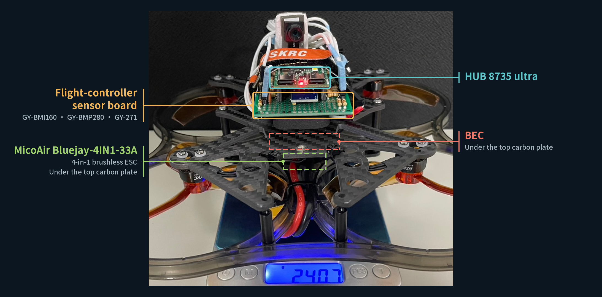
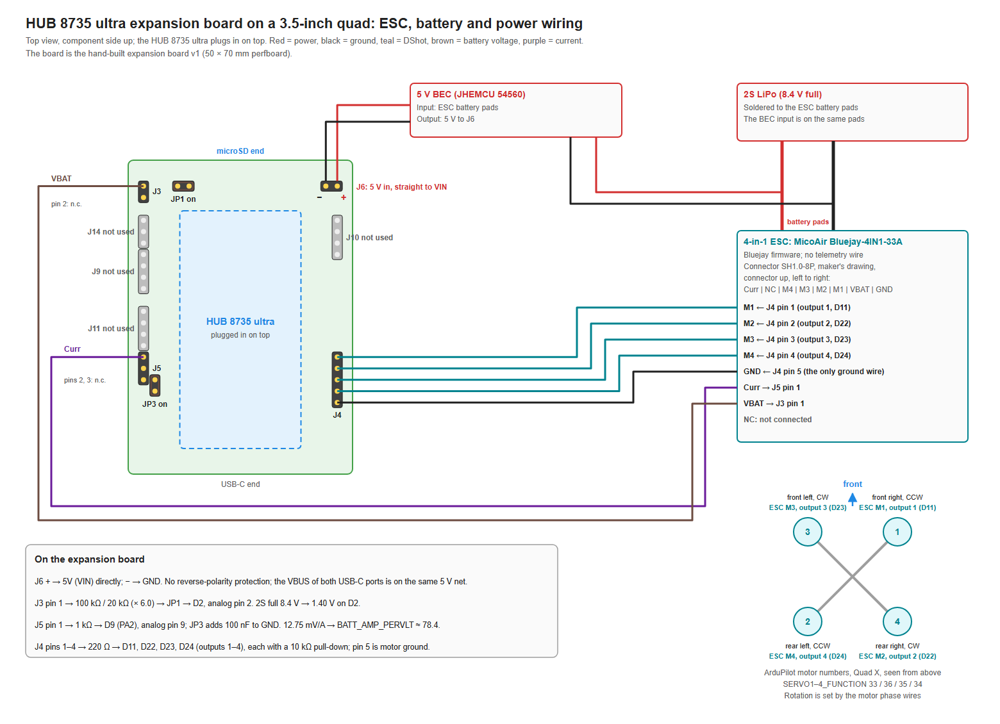

# HUB 8735 ultra on its expansion board

[繁體中文](README.zh-TW.md)

## Introduction

The board type `hub8735ultra-expansion` is a HUB 8735 ultra plugged in on top of a hand-built expansion board. The expansion board carries an IMU, a barometer and a compass on breakout modules, and connectors for the ESC, the battery voltage, 5 V power, a GPS, an RC receiver and an external I²C bus. The board type includes `hub8735ultra`: the development board's pins, serial ports, PWM outputs, Wi-Fi and microSD are as in [its README](../hub8735ultra/README.md).

This hardware flew a 3.5-inch quadcopter under ArduPilot Copter on 2026-10-25 and 2026-11-06, controlled from a ground station over Wi-Fi MAVLink, with DShot300 to a MicoAir Bluejay-4IN1-33A 4-in-1 ESC (Bluejay firmware); the record is T5 in [BOARD_TESTS.md](../../BOARD_TESTS.md) (in Chinese). Video of the 2026-11-06 flight: [flight-2026-11-06.mp4](flight-2026-11-06.mp4).



The board's status is under [Status](#status).

## Specifications

- Development board: HUB 8735 ultra, see [its specifications](../hub8735ultra/README.md#specifications).
- Expansion board: hand-built on a 50 × 70 mm perfboard (18 × 24 holes); the HUB 8735 ultra plugs in on top.
- IMU: Bosch BMI160 on a GY-BMI160 module, SPI bus 1.
- Barometer: Bosch BMP280 on a GY-BMP280 module (silkscreen GY-BME/PMP280), I²C bus 1, address 0x76.
- Compass: QST QMC5883L on a GY-271 module, I²C bus 1, address 0x0D, external.
- Connectors: 5 V power input (J6), battery voltage (J3), four motor outputs (J4), ESC current and telemetry (J5), external I²C (J9), GPS (J10), RC receiver (J11), an ADC test header (J14), and two jumpers (JP1, JP3).
- Power: J6 goes straight to the development board's 5 V (VIN), with no reverse-polarity protection; the VBUS of both USB-C connectors is on the same 5 V net.
- Ground: power ground (JA1.2), sensor ground (JA2.4) and motor ground (JA2.8) are separate on the expansion board and meet only at the development board's header pins.

### Status

| Item | Status |
|---|---|
| This hardware flying a 3.5-inch quadcopter: BMI160, BMP280, QMC5883L, DShot300, battery voltage, Wi-Fi MAVLink, parameters in flash | Works (T5) |
| Firmware built from this board type, on the board | Needs: one try on a board |
| Battery voltage | Needs: calibration with a meter |
| Battery current (ESC current output on J5) | Needs: one measurement on a board, then calibration |
| Compass | Needs: orientation check and calibration |
| Frame parameter file | Needs: one try on a board |
| Failsafe on ground station link loss | Needs: one rehearsal with the propellers off |
| ESC telemetry on J5 | Needs: one try with an ESC that has telemetry |
| GPS on J10 (SERIAL1) | Needs: one try with a GPS |
| RC receiver on J11 (SERIAL4) | Needs: one try with a receiver |
| External I²C on J9 (I²C bus 2) | Needs: one try on a board |

The status of the development board's other features is in [its Status](../hub8735ultra/README.md#status), and of each HAL feature in [Feature status](../../docs/feature-status.md).

## Where to Buy

The expansion board is built by hand, as in [Building the expansion board](perfboard.md); it is not sold. The HUB 8735 ultra is in [its README](../hub8735ultra/README.md#where-to-buy).

## Pinout

The expansion board's connectors are fixed; the sensor modules plugged into it can be changed. The tables below are separate for the two. Which holes each part goes in and the route of every wire are in [Building the expansion board](perfboard.md).

Pins of the development board are written as D numbers with the chip pin in brackets, for example D19 (PF6), as in the [HUB 8735 ultra pinout](../hub8735ultra/README.md#pinout).

### Sensor module sockets

| Socket | Pin | To the development board | Use |
|---|---|---|---|
| U1 (1×7, IMU) | 1 | Not connected | — |
| U1 | 2 | 3.3V (JA2.1) | Power |
| U1 | 3 | GND (JA2.4, sensor ground) | Ground |
| U1 | 4 | D19 (PF6) | SPI bus 1 SCLK |
| U1 | 5 | D20 (PF7) | SPI bus 1 MOSI |
| U1 | 6 | D21 (PF8) | SPI bus 1 CS (device `bmi160`) |
| U1 | 7 | D18 (PF5) | SPI bus 1 MISO |
| U2 (1×6, barometer) | 1 | 3.3V | Power |
| U2 | 2 | GND (sensor ground) | Ground |
| U2 | 3 | D1 (PF1) | I²C bus 1 SCL |
| U2 | 4 | D0 (PF2) | I²C bus 1 SDA |
| U2 | 5 | 3.3V | Tied high |
| U2 | 6 | GND (sensor ground) | Tied low |
| U3 (1×5, compass) | 1 | 3.3V | Power |
| U3 | 2 | GND (sensor ground) | Ground |
| U3 | 3 | D1 (PF1) | I²C bus 1 SCL |
| U3 | 4 | D0 (PF2) | I²C bus 1 SDA |
| U3 | 5 | Not connected | — |

- I²C bus 1 uses the pull-ups on the modules. R1 and R2 on the expansion board are places for 10 kΩ pull-ups, fitted only when no compass module is installed.
- Positions, seen from the component side with columns A–R from left to right and row 1 at the microSD end: U2 at G5–L5, U1 at L11–L17, U3 at G19–K19, all under the development board. The bodies of the U2 and U3 modules point to the USB-C end, and U1's to the left.

### Connectors and jumpers

| Connector | Pin | To the development board | Parts in between |
|---|---|---|---|
| J6 power input | 1 (+) | 5V (VIN, JA1.1), directly | None: no reverse-polarity protection, no blocking diode to USB |
| J6 | 2 (−) | GND (JA1.2, power ground) | |
| J3 battery voltage | 1 | D2 (PF0, analog pin 2) through the divider | R3 100 kΩ (1%) to the divider node; the node goes through R4 20 kΩ (1%) and C1 100 nF to power ground, and through jumper JP1 to D2. Ratio ×6.0 |
| J3 | 2 | GND (power ground) | |
| JP1 | 1–2 | Divider node ↔ D2 | On: D2 measures the battery. Off: D2 goes only to J14 |
| J14 test header | 1 / 2 / 3 | GND (power ground) / D2 through R23 1 kΩ / 3.3V | |
| J4 motor outputs | 1 | D11 (PF14), output 1 | R5 220 Ω in series; R9 10 kΩ to motor ground |
| J4 | 2 | D22 (PF11), output 2 | R6 220 Ω; R10 10 kΩ pull-down |
| J4 | 3 | D23 (PF12), output 3 | R7 220 Ω; R11 10 kΩ pull-down |
| J4 | 4 | D24 (PF13), output 4 | R8 220 Ω; R12 10 kΩ pull-down |
| J4 | 5 | GND (JA2.8, motor ground) | |
| J5 ESC / SERIAL3 | 1 | D9 (PA2), analog pin 9 | R16 1 kΩ in series; on the D9 side, C8 100 nF to sensor ground through jumper JP3 |
| J5 | 2 | D10 (PA3), SERIAL3 RX | R13 1 kΩ in series; R24 10 kΩ to 3.3V |
| J5 | 3 | GND (sensor ground) | |
| JP3 | 1–2 | C8 ↔ sensor ground | On: filter for D9 as an analog input. Off when J5 pin 1 is used as a serial pin |
| J9 external I²C (I²C bus 2) | 1 / 2 / 3 / 4 | GND / 3.3V / D3 (PE4, SDA) / D4 (PE3, SCL), 400 kHz | 10 kΩ pull-ups to 3.3V on pins 3 and 4 (R20, R21) |
| J10 GPS (SERIAL1) | 1 / 2 / 3 / 4 | 5V (VIN) / D8 (PD15, TX) / D15 (PD16, RX) / GND | R17 100 Ω in series with TX; R14 1 kΩ in series with RX |
| J11 RC receiver (SERIAL4) | 1 / 2 / 3 / 4 | 5V (VIN) / D6 (PE1, TX) / D5 (PE2, RX) / GND | R18 100 Ω in series with TX; R15 1 kΩ in series with RX |

- Development board pins not connected to the expansion board: D7, D12 (upgrade button), D13 (fill light), D14 (boot mode pin), D16 and D17 (LOG UART), VCC (JA2.5) and SPK.
- Pin 1 of J10 and J11 is the same 5 V (VIN) as J6 and the USB-C connectors.

### Sensor modules

Chip pin names follow the makers' datasheets, with the chip pin number in brackets; the module pin names are the silkscreen on the module.

GY-BMI160 (IMU, Bosch BMI160, SPI; datasheet `BST-BMI160-DS000-09`, Table 30):

| Module pin | Chip pin | Use on this board |
|---|---|---|
| VIN | — | Not connected |
| 3V3 | VDD (8), VDDIO (5) | 3.3 V power (U1 pin 2) |
| GND | GND (7), GNDIO (6) | Ground |
| SCL | SCx (13) | SPI SCK, to D19 |
| SDA | SDx (14) | SPI data in (MOSI), to D20 |
| CS | CSB (12) | SPI CS, to D21 |
| SAO | SDO (1) | SPI data out (MISO), to D18 |
| OCS | — | Not connected |
| INT2 | — | Not connected |
| INT1 | — | Not connected |
| SCX | — | Not connected |
| SDX | — | Not connected |

- Only the 7-pin row of the module has header pins, plugged into U1; the other row (OCS, INT2, INT1, SCX, SDX) has none.

GY-BME/PMP280 (barometer, Bosch BMP280, I²C address 0x76; datasheet `BST-BMP280-DS001-26`, Table 29):

| Module pin | Chip pin | Use on this board |
|---|---|---|
| VCC | VDD (8), VDDIO (6) | 3.3 V power |
| GND | GND (1, 7) | Ground |
| SCL | SCK (4) | I²C SCL, to D1 |
| SDA | SDI (3) | I²C SDA, to D0 |
| CSB | CSB (2) | To 3.3 V: selects I²C |
| SDO | SDO (5) | To GND: address 0x76 (0x77 when tied to 3.3 V) |

- The same module board is also sold with a BME280.

GY-271 (compass, QST QMC5883L, I²C address 0x0D; datasheet QMC5883L 1.0, Table 5):

| Module pin | Chip pin | Use on this board |
|---|---|---|
| VCC | VDD (2), VDDIO (13) | 3.3 V power |
| GND | GND (9, 11) | Ground |
| SCL | SCL (1) | I²C SCL, to D1 |
| SDA | SDA (16) | I²C SDA, to D0 |
| DRDY | — | Not connected |

- The module is also marked HW-246. GY-271 modules are made with either an HMC5883L (address 0x1E) or a QMC5883L (0x0D); this board type is set up for the QMC5883L.

## Wiring Diagram



Vector version: [wiring.svg](wiring.svg).

- This is the wiring of the T5 quadcopter: a 2S LiPo on the battery pads of the MicoAir Bluejay-4IN1-33A, a 5 V BEC from the same pads into J6, the ESC's VBAT into J3 and its current output into J5 pin 1, and J4 pins 1–4 to the ESC's M1–M4. J4 pin 5 is the only ground wire between the expansion board and the ESC.
- J4 pins 1–4 go straight to the ESC's M1–M4. On the T5 quadcopter, outputs 1–4 drive motors 1, 4, 3 and 2: the frame parameter file sets `SERVO1_FUNCTION` to `SERVO4_FUNCTION` to 33, 36, 35 and 34, as in the diagram.
- J9, J10, J11 and J14 are not used on the T5 quadcopter.

Mounting orientation:

- The IMU line in `hwdef.dat` has `ROTATION_ROLL_180_YAW_270`: the expansion board's component side up, with the microSD end towards the front.
- When the board sits differently on the frame, `AHRS_ORIENTATION` sets it without rebuilding; the external compass's orientation is `COMPASS_ORIENT`. The T5 quadcopter uses `AHRS_ORIENTATION` 12 and `COMPASS_ORIENT` 8 (in the frame parameter file).
- Gravity test (IMU orientation). ArduPilot's body frame is X forward, Y right, Z down. With the vehicle still, the ground station's raw accelerometer values (mG) are:

  | Position | Expected |
  |---|---|
  | Level, right way up | Z about −1000, X and Y about 0 |
  | Front down | X about −1000 |
  | Right side down | Y about −1000 |
  | Left side down | Y about +1000 |

  When a sign is wrong or another axis moves, `AHRS_ORIENTATION` is changed (or, for the board type itself, the IMU line in `hwdef.dat`), and the test is run again.
- Heading test (compass orientation), after compass calibration: with the vehicle level, turning it 90° clockwise increases both the magnetic heading and the EKF yaw by about 90°, within a few degrees of each other, and turning it back returns both. When the heading moves the other way, or by a different angle, `COMPASS_ORIENT` is changed, the compass calibrated again, and the test run again.

## UART Mapping

| SERIALn | Chip UART | TX | RX | Default protocol | On the expansion board |
|---|---|---|---|---|---|
| SERIAL0 | UART1 (LOG UART) | D17 (PF4) | D16 (PF3) | MAVLink2, 115200 baud | Not connected: USB-C CNA1 on the development board |
| SERIAL1 | UART2 | D8 (PD15) | D15 (PD16) | GPS (5) | J10 |
| SERIAL2 | — | — | — | MAVLink2 | Wi-Fi, see *Wi-Fi Module* |
| SERIAL3 | UART0 | None | D10 (PA3) | ESC telemetry (16) | J5 pin 2 |
| SERIAL4 | UART3 | D6 (PE1) | D5 (PE2) | RC input (23) | J11 |

- SERIAL3 receives only: its TX pin D9 (PA2) is analog pin 9 for the ESC current.
- The ESC on the T5 quadcopter has no telemetry wire, so J5 pin 2 is not connected there.
- Serial formats, voltage levels and SERIAL0 are as in the [HUB 8735 ultra UART mapping](../hub8735ultra/README.md#uart-mapping).

## PWM Output

| Output | Pin | Connector |
|---|---|---|
| 1 | D11 (PF14) | J4 pin 1 |
| 2 | D22 (PF11) | J4 pin 2 |
| 3 | D23 (PF12) | J4 pin 3 |
| 4 | D24 (PF13) | J4 pin 4 |

- `defaults.parm` sets DShot300 (`MOT_PWM_TYPE` 5) with the Bluejay ESC type (`SERVO_DSHOT_ESC` 2). Other output types and their limits are in [Motor outputs](../../docs/motor-outputs.md).
- Each output has 220 Ω in series and a 10 kΩ pull-down to motor ground; J4 pin 5 is motor ground.

## RC Input

- An RC receiver connects to J11 (SERIAL4): 5 V on pin 1, the receiver's TX to pin 3 (D5, RX), its RX to pin 2 (D6, TX), ground on pin 4. The serial RC protocols are as in the [HUB 8735 ultra RC input](../hub8735ultra/README.md#rc-input).
- The T5 quadcopter used no receiver: a joystick on the ground station sent RC override over Wi-Fi MAVLink, see *Parameters*.

## Wi-Fi Module

As on the HUB 8735 ultra, see [its Wi-Fi Module](../hub8735ultra/README.md#wi-fi-module) and [Wi-Fi](../../docs/wifi.md).

## GPIOs

As on the HUB 8735 ultra, see [its GPIOs](../hub8735ultra/README.md#gpios). D7 is not connected to the expansion board.

## Analog Pins

| Analog pin | Pin | Connector | Use |
|---|---|---|---|
| 2 | D2 (PF0) | J3 through the ×6.0 divider and JP1; J14 pin 2 | Battery voltage |
| 9 | D9 (PA2) | J5 pin 1 through R16 1 kΩ; C8 through JP3 | Battery current from the ESC |

- Full scale is 3.3 V. A full 2S battery (8.4 V) gives 1.40 V on D2; 4 × 33 A gives 1.68 V on D9.

## Battery Monitoring

- `hwdef.dat` sets analog voltage and current as the default (`BATT_MONITOR` 4): voltage on analog pin 2 with `BATT_VOLT_MULT` 6.0, current on analog pin 9 with `BATT_AMP_PERVLT` 78.43 (the ESC's current output, 12.75 mV/A).
- `BATT_VOLT_MULT` 6.0 is the nominal ratio of the 100 kΩ / 20 kΩ divider, and `BATT_AMP_OFFSET` is ArduPilot's default 0; both are calibrated on each vehicle, see *Parameters*.
- Status: see [Status](#status).

## Compass

- The QMC5883L is on I²C bus 1 at 0x0D, marked external, `ROTATION_NONE` in `hwdef.dat`. `hwdef.dat` lists only this compass; automatic probing for other external compasses is off.
- Its orientation on the vehicle is `COMPASS_ORIENT`, checked with the heading test under *Wiring Diagram*.
- Status: see [Status](#status).

## Parameters

Three groups: what the board type sets, what the frame parameter file sets, and what you set on your own vehicle. The definitions, units and ranges are those of ArduPilot's parameter documentation; "list" means the parameter takes one of the listed values.

### Set by the board type

These defaults are built into the firmware. A value already saved on the board takes precedence over them.

In `hwdef.dat`:

| Parameter | Value | Unit | Range | From |
|---|---|---|---|---|
| `BATT_MONITOR` | 4 | — | List; 4 is analog voltage and current | Voltage on J3, current on J5 |
| `BATT_VOLT_PIN` | 2 | — | −1 to 127 | D2, analog pin 2 |
| `BATT_VOLT_MULT` | 6.0 | — | — | 100 kΩ / 20 kΩ divider, nominal |
| `BATT_CURR_PIN` | 9 | — | −1 to 127 | D9, analog pin 9 |
| `BATT_AMP_PERVLT` | 78.43 | A/V | — | ESC current output, 12.75 mV/A |
| `SERIAL1_PROTOCOL` | 5 | — | List; 5 is GPS | J10 |

In `defaults.parm` in this folder:

| Parameter | Value | Unit | Range | From |
|---|---|---|---|---|
| `MOT_PWM_TYPE` | 5 | — | List; 5 is DShot300 | J4 outputs 1–4 |
| `SERVO_DSHOT_ESC` | 2 | — | List; 2 is BLHeli_S/BlueJay | Bluejay ESC |
| `SERVO_BLH_AUTO` | 1 | — | 0 or 1 | BLHeli pass-through on the motor outputs |

`hwdef.dat` also sets SERIAL3 to receive only, with ESC telemetry as its default protocol, and D9 (PA2) as analog pin 9.

### Set by the frame parameter file

[`Tools/Frame_params/hub8735ultra-expansion-quad-3.5in-2S.param`](../../../../Tools/Frame_params/hub8735ultra-expansion-quad-3.5in-2S.param) is for a 3.5-inch quad X with a 4-in-1 Bluejay ESC on DShot300 and a 2S battery, as on the T5 quadcopter. It is loaded from the ground station; it does not repeat the board type's defaults.

| Parameter | Value | Unit | Range | From |
|---|---|---|---|---|
| `FRAME_CLASS` | 1 | — | List; 1 is Quad | Quadcopter |
| `FRAME_TYPE` | 1 | — | List; 1 is X | X frame |
| `SERVO1_FUNCTION` to `SERVO4_FUNCTION` | 33, 36, 35, 34 | — | List; 33–36 are Motor1–Motor4 | Wiring of the T5 quadcopter, see *Wiring Diagram* |
| `SERVO1_MIN` to `SERVO4_MIN` | 1000 | PWM | 800 to 2200 | |
| `SERVO1_MAX` to `SERVO4_MAX` | 2000 | PWM | 800 to 2200 | |
| `SERVO1_TRIM` to `SERVO4_TRIM` | 1000 | PWM | 800 to 2200 | |
| `BATT_LOW_VOLT` | 7.2 | V | — | 2S battery |
| `BATT_CRT_VOLT` | 7.0 | V | — | 2S battery |
| `BATT_FS_LOW_ACT` | 1 | — | List; 1 is Land | |
| `BATT_FS_CRT_ACT` | 1 | — | List; 1 is Land | |
| `BATT_ARM_VOLT` | 7.3 | V | — | |
| `BATT_CAPACITY` | 550 | mAh | — | |
| `MOT_BAT_VOLT_MAX` | 8.4 | V | 6 to 53 | ArduPilot's recommendation, 4.2 V per cell, for 2S |
| `MOT_BAT_VOLT_MIN` | 6.6 | V | 6 to 42 | ArduPilot's recommendation, 3.3 V per cell, for 2S |
| `MOT_THST_EXPO` | 0.43 | — | −1.0 to 1.0 | |
| `MOT_THST_HOVER` | 0.2 | — | 0.125 to 0.6875 | |
| `ATC_RAT_RLL_FLTT`, `ATC_RAT_RLL_FLTD`, `ATC_RAT_PIT_FLTT`, `ATC_RAT_PIT_FLTD`, `ATC_RAT_YAW_FLTT` | 50.5 | Hz | — | |
| `ATC_RAT_YAW_FLTD` | 0 | Hz | — | |
| `ATC_RAT_YAW_FLTE` | 2 | Hz | — | |
| `INS_ACCEL_FILTER` | 10 | Hz | 0 to 256 | |
| `INS_GYRO_FILTER` | 101 | Hz | 0 to 256 | |
| `GPS1_TYPE` | 0 | — | List; 0 is None | No GPS |
| `FS_GCS_ENABLE` | 5 | — | List; 5 is Land | With either control method, a lost link lands, or continues a landing |
| `FS_OPTIONS` | 8 | — | Bitmask; bit 3 is continue if landing on any failsafe | |
| `FS_THR_ENABLE` | 3 | — | List; 3 is enabled, always land | |
| `AHRS_ORIENTATION` | 12 | — | List; 12 is Pitch180 | Mounting on the T5 quadcopter |
| `COMPASS_ORIENT` | 8 | — | List; 8 is Roll180 | Mounting on the T5 quadcopter |

### Set by you

These differ on each vehicle and are in neither file:

1. Mounting orientation: `AHRS_ORIENTATION` and `COMPASS_ORIENT` for how the board sits on your frame, checked with the gravity and heading tests under *Wiring Diagram*.
2. Motor test, with the propellers off: in the ground station's motor test, each motor's position and direction match ArduPilot's quad X. Where they do not, the `SERVOn_FUNCTION` values or the motor wires change.
3. Calibration: accelerometer; compass; battery voltage, by comparing `BATT_VOLT_MULT` with a meter; battery current zero, `BATT_AMP_OFFSET` (V, default 0), with the vehicle idle. DShot ESCs need no throttle range calibration.
4. Control method: `RC_OPTIONS` and the `RCn_OPTION` switches go with how you fly. The T5 quadcopter flew with a ground station joystick over Wi-Fi MAVLink, with `RC_OPTIONS` 33 (bit 0, ignore the RC receiver; bit 5, arming check throttle for 0 input) and `RC9_OPTION` 81 (Disarm). With an RC receiver on J11, these are set for your transmitter, and the failsafes are tried on the ground before flying.
5. Battery: `BATT_CAPACITY` is set to your battery's capacity (mAh).
6. Logs: `LOG_BACKEND_TYPE` (bitmask; bit 0 is File, on the microSD card). The T5 quadcopter flew with 0, no logs.

## Firmware

```bash
./waf configure --board hub8735ultra-expansion
./waf copter
```

- The image is `build/hub8735ultra-expansion/sdk_build/flash_ntz.bin`. Setting up the tools and the SDK, and the Wi-Fi settings file, are in [Build the firmware](../../docs/building.md).
- `hwdef.dat` includes [`../hub8735ultra/hwdef.dat`](../hub8735ultra/hwdef.dat) and adds the three sensors, I²C bus 2 on D3 and D4, SERIAL3 receive-only, analog pin 9, the battery monitor and GPS defaults, and `defaults.parm`. No overlay is needed.
- This repository does not provide firmware images.

## Loading Firmware

As on the HUB 8735 ultra, see [its Loading Firmware](../hub8735ultra/README.md#loading-firmware), with the battery disconnected. Before plugging in USB, disconnect the power from J6.

## Other Links

- [HUB 8735 ultra](../hub8735ultra/README.md): the development board, its pins and how to flash it.
- [BOARD_TESTS.md](../../BOARD_TESTS.md) T5 (in Chinese): the flights of this hardware.
- Frame parameter file: [`Tools/Frame_params/hub8735ultra-expansion-quad-3.5in-2S.param`](../../../../Tools/Frame_params/hub8735ultra-expansion-quad-3.5in-2S.param).
- Sensor datasheets:
  - Bosch BMI160, `BST-BMI160-DS000-09`, revision 1.0, November 2020: [bst-bmi160-ds000.pdf](https://www.bosch-sensortec.com/media/boschsensortec/downloads/datasheets/bst-bmi160-ds000.pdf)
  - Bosch BMP280, `BST-BMP280-DS001-26`, revision 1.26, October 2021: [bst-bmp280-ds001.pdf](https://www.bosch-sensortec.com/media/boschsensortec/downloads/datasheets/bst-bmp280-ds001.pdf)
  - QST QMC5883L datasheet, version 1.0, February 2016
- The sensor lines in `hwdef.dat` are adapted from `examples/bmi160-bmp280-qmc5883l/overlay.dat` in [rainwu0/ArduPilot-Hub8735Ultra](https://github.com/rainwu0/ArduPilot-Hub8735Ultra) at `0c18d8c51a`.
