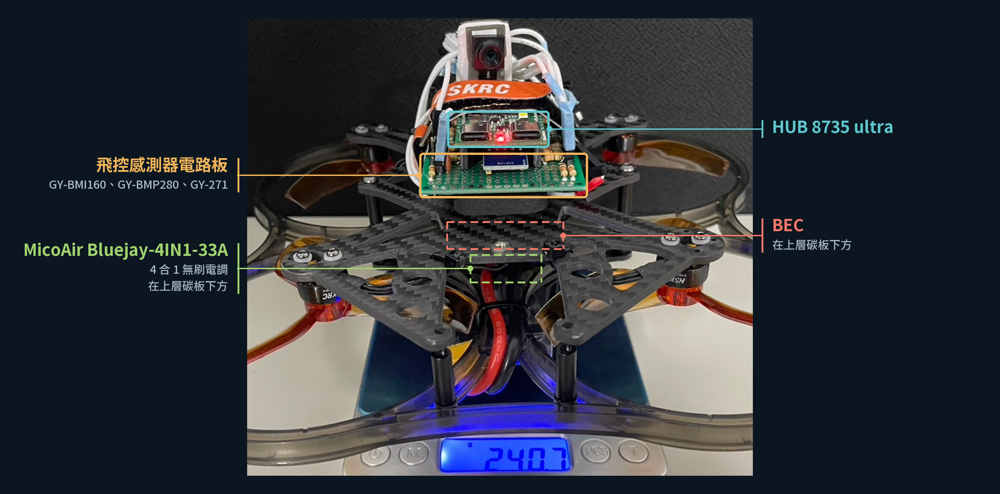
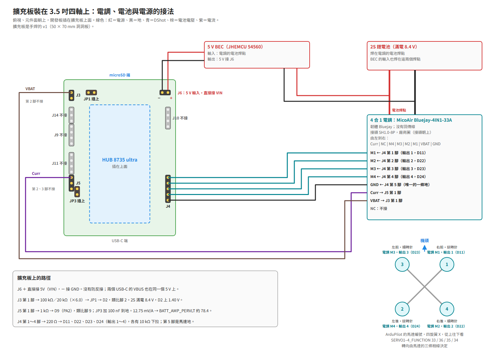

# HUB 8735 ultra 加擴充板

[English](README.md)

## 簡介

板型 `hub8735ultra-expansion` 是 HUB 8735 ultra 插在一塊手焊擴充板上。擴充板以模組裝了 IMU、氣壓計與羅盤，另有電調、電池電壓、5 V 電源、GPS、遙控接收機與外接 I²C 的接點。這個板型 include `hub8735ultra`：開發板的接腳、序列埠、PWM 輸出、Wi-Fi 與 microSD 照[它的 README](../hub8735ultra/README.zh-TW.md)。

這套硬體在 2026-10-25 與 2026-11-06 以 ArduPilot Copter 飛了一台 3.5 吋四軸，由地面站經 Wi-Fi MAVLink 遙控，DShot300 輸出到 MicoAir Bluejay-4IN1-33A 4 合 1 電調（韌體 Bluejay）；紀錄是 [BOARD_TESTS.md](../../BOARD_TESTS.md) 的 T5。2026-11-06 那次飛行的影片：[flight-2026-11-06.mp4](flight-2026-11-06.mp4)。



板子的現況見[現況](#現況)。

## 規格

- 開發板：HUB 8735 ultra，見[它的規格](../hub8735ultra/README.zh-TW.md#規格)。
- 擴充板：手焊在 50 × 70 mm 的洞洞板上（18 × 24 孔），HUB 8735 ultra 插在上面。
- IMU：Bosch BMI160，GY-BMI160 模組，SPI 匯流排 1。
- 氣壓計：Bosch BMP280，GY-BMP280 模組（絲印 GY-BME/PMP280），I²C 匯流排 1，位址 0x76。
- 羅盤：QST QMC5883L，GY-271 模組，I²C 匯流排 1，位址 0x0D，外接。
- 接點：5 V 電源輸入（J6）、電池電壓（J3）、四路馬達輸出（J4）、電調電流與遙測（J5）、外接 I²C（J9）、GPS（J10）、遙控接收機（J11）、ADC 量測排針（J14），以及兩個跳帽（JP1、JP3）。
- 電源：J6 直接接開發板的 5V（VIN），沒有防反接；兩個 USB-C 的 VBUS 也在同一條 5 V 上。
- 地：電源地（JA1.2）、感測地（JA2.4）、馬達地（JA2.8）在擴充板上分開，只在開發板的排針上相接。

### 現況

| 項目 | 現況 |
|---|---|
| 這套硬體飛 3.5 吋四軸：BMI160、BMP280、QMC5883L、DShot300、電池電壓、Wi-Fi MAVLink、參數存在 Flash | 能用（T5） |
| 用這個板型建置的韌體，上板 | 要補：上板驗一次 |
| 電池電壓 | 要補：用電錶校正 |
| 電池電流（J5 的電調電流輸出） | 要補：上板量一次，再校正 |
| 羅盤 | 要補：確認方向與校正 |
| 整機參數檔 | 要補：上板驗一次 |
| 地面站斷線的失效保護 | 要補：拆槳演練一次 |
| J5 的電調遙測 | 要補：用有遙測的電調試一次 |
| J10 的 GPS（SERIAL1） | 要補：接 GPS 試一次 |
| J11 的遙控接收機（SERIAL4） | 要補：接接收機試一次 |
| J9 的外接 I²C（I²C 匯流排 2） | 要補：上板驗一次 |

開發板其他功能的現況見[它的現況](../hub8735ultra/README.zh-TW.md#現況)，HAL 各功能的現況見[功能狀態](../../docs/feature-status.zh-TW.md)。

## 購買

擴充板照〈接腳〉的表手焊，沒有販售。HUB 8735 ultra 見[它的 README](../hub8735ultra/README.zh-TW.md#購買)。

## 接腳

擴充板的接點是固定的，插在上面的感測器模組可以換，下面兩者分開列表。

開發板的腳寫 D 編號，括號是晶片腳，例如 D19（PF6），和 [HUB 8735 ultra 的接腳](../hub8735ultra/README.zh-TW.md#接腳)相同。

### 感測器模組的座

| 座 | 腳 | 接到開發板 | 用途 |
|---|---|---|---|
| U1（1×7，IMU） | 1 | 不接 | — |
| U1 | 2 | 3.3V（JA2.1） | 電源 |
| U1 | 3 | GND（JA2.4，感測地） | 地 |
| U1 | 4 | D19（PF6） | SPI 匯流排 1 SCLK |
| U1 | 5 | D20（PF7） | SPI 匯流排 1 MOSI |
| U1 | 6 | D21（PF8） | SPI 匯流排 1 CS（裝置 `bmi160`） |
| U1 | 7 | D18（PF5） | SPI 匯流排 1 MISO |
| U2（1×6，氣壓計） | 1 | 3.3V | 電源 |
| U2 | 2 | GND（感測地） | 地 |
| U2 | 3 | D1（PF1） | I²C 匯流排 1 SCL |
| U2 | 4 | D0（PF2） | I²C 匯流排 1 SDA |
| U2 | 5 | 3.3V | 拉高 |
| U2 | 6 | GND（感測地） | 拉低 |
| U3（1×5，羅盤） | 1 | 3.3V | 電源 |
| U3 | 2 | GND（感測地） | 地 |
| U3 | 3 | D1（PF1） | I²C 匯流排 1 SCL |
| U3 | 4 | D0（PF2） | I²C 匯流排 1 SDA |
| U3 | 5 | 不接 | — |

- I²C 匯流排 1 用模組上的上拉。擴充板上 R1、R2 的位置是 10 kΩ 上拉，只在沒裝羅盤模組時焊上。
- 位置（從零件面看，A～R 欄由左到右，第 1 列在 microSD 端）：U2 在 G5～L5，U1 在 L11～L17，U3 在 G19～K19，都在開發板正下方。U2、U3 的模組本體朝 USB-C 端，U1 朝左。

### 排針與跳帽

| 接點 | 腳 | 接到開發板 | 中間的零件 |
|---|---|---|---|
| J6 電源輸入 | 1（＋） | 5V（VIN，JA1.1），直接相接 | 無：沒有防反接，也沒有和 USB 之間的防倒灌 |
| J6 | 2（－） | GND（JA1.2，電源地） | |
| J3 電池電壓 | 1 | 經分壓到 D2（PF0，類比腳 2） | R3 100 kΩ（1%）到分壓點；分壓點經 R4 20 kΩ（1%）、C1 100 nF 到電源地，經跳帽 JP1 到 D2。比例 ×6.0 |
| J3 | 2 | GND（電源地） | |
| JP1 | 1–2 | 分壓點 ↔ D2 | 插上：D2 量電池；拔掉：D2 只接 J14 |
| J14 量測排針 | 1／2／3 | GND（電源地）／D2 經 R23 1 kΩ／3.3V | |
| J4 馬達輸出 | 1 | D11（PF14），輸出 1 | 串 R5 220 Ω；R9 10 kΩ 到馬達地 |
| J4 | 2 | D22（PF11），輸出 2 | R6 220 Ω；R10 10 kΩ 下拉 |
| J4 | 3 | D23（PF12），輸出 3 | R7 220 Ω；R11 10 kΩ 下拉 |
| J4 | 4 | D24（PF13），輸出 4 | R8 220 Ω；R12 10 kΩ 下拉 |
| J4 | 5 | GND（JA2.8，馬達地） | |
| J5 電調／SERIAL3 | 1 | D9（PA2），類比腳 9 | 串 R16 1 kΩ；D9 那側經 C8 100 nF 與跳帽 JP3 到感測地 |
| J5 | 2 | D10（PA3），SERIAL3 RX | 串 R13 1 kΩ；R24 10 kΩ 到 3.3V |
| J5 | 3 | GND（感測地） | |
| JP3 | 1–2 | C8 ↔ 感測地 | 插上：D9 當類比輸入時的濾波；J5 第 1 腳當序列埠用時拔掉 |
| J9 外接 I²C（I²C 匯流排 2） | 1／2／3／4 | GND／3.3V／D3（PE4，SDA）／D4（PE3，SCL），400 kHz | 3、4 腳各有 10 kΩ（R20、R21）到 3.3V |
| J10 GPS（SERIAL1） | 1／2／3／4 | 5V（VIN）／D8（PD15，TX）／D15（PD16，RX）／GND | TX 串 R17 100 Ω；RX 串 R14 1 kΩ |
| J11 遙控接收機（SERIAL4） | 1／2／3／4 | 5V（VIN）／D6（PE1，TX）／D5（PE2，RX）／GND | TX 串 R18 100 Ω；RX 串 R15 1 kΩ |

- 開發板上沒接到擴充板的腳：D7、D12（upgrade 鍵）、D13（補光燈）、D14（開機模式腳）、D16 與 D17（LOG UART）、VCC（JA2.5）、SPK。
- J10、J11 的第 1 腳和 J6、USB-C 是同一條 5 V（VIN）。

### 感測器模組

晶片腳名照原廠資料表，括號是晶片的腳號；模組腳名照模組上的絲印。

GY-BMI160（IMU，Bosch BMI160，SPI；資料表 `BST-BMI160-DS000-09` Table 30）：

| 模組絲印 | 晶片腳名 | 在這塊板上的用途 |
|---|---|---|
| VIN | — | 本板未接 |
| 3V3 | VDD（8）、VDDIO（5） | 3.3 V 電源（U1 第 2 腳） |
| GND | GND（7）、GNDIO（6） | 地 |
| SCL | SCx（13） | SPI SCK，接 D19 |
| SDA | SDx（14） | SPI 資料輸入（MOSI），接 D20 |
| CS | CSB（12） | SPI CS，接 D21 |
| SAO | SDO（1） | SPI 資料輸出（MISO），接 D18 |
| OCS | — | 本板未接 |
| INT2 | — | 本板未接 |
| INT1 | — | 本板未接 |
| SCX | — | 本板未接 |
| SDX | — | 本板未接 |

- 模組只有 7 腳那一排焊了排針，插在 U1；另一排（OCS、INT2、INT1、SCX、SDX）沒有焊。

GY-BME/PMP280（氣壓計，Bosch BMP280，I²C 位址 0x76；資料表 `BST-BMP280-DS001-26` Table 29）：

| 模組絲印 | 晶片腳名 | 在這塊板上的用途 |
|---|---|---|
| VCC | VDD（8）、VDDIO（6） | 3.3 V 電源 |
| GND | GND（1、7） | 地 |
| SCL | SCK（4） | I²C SCL，接 D1 |
| SDA | SDI（3） | I²C SDA，接 D0 |
| CSB | CSB（2） | 接 3.3 V：選 I²C |
| SDO | SDO（5） | 接 GND：位址 0x76（接 3.3 V 是 0x77） |

- 同一塊模組板也有焊 BME280 的版本。

GY-271（羅盤，QST QMC5883L，I²C 位址 0x0D；資料表 QMC5883L 1.0 Table 5）：

| 模組絲印 | 晶片腳名 | 在這塊板上的用途 |
|---|---|---|
| VCC | VDD（2）、VDDIO（13） | 3.3 V 電源 |
| GND | GND（9、11） | 地 |
| SCL | SCL（1） | I²C SCL，接 D1 |
| SDA | SDA（16） | I²C SDA，接 D0 |
| DRDY | — | 本板未接 |

- 模組另印 HW-246。GY-271 這個名字的模組，有焊 HMC5883L（位址 0x1E）的，也有焊 QMC5883L（0x0D）的；這個板型設定的是 QMC5883L。

## 接線圖



向量版：[wiring.zh-TW.svg](wiring.zh-TW.svg)。

- 這是 T5 那台四軸的接法：2S 鋰電池焊在 MicoAir Bluejay-4IN1-33A 的電池焊點，5 V BEC 從同一組焊點取電接 J6；電調的 VBAT 接 J3、電流輸出接 J5 第 1 腳；J4 第 1～4 腳接電調的 M1～M4。J4 第 5 腳是擴充板和電調之間唯一的地線。
- J4 第 1～4 腳直接接電調的 M1～M4。T5 那台四軸在電調到馬達的接線上把 2、4 號馬達對調，用 `SERVO2_FUNCTION` 36、`SERVO4_FUNCTION` 34。整機參數檔用 ArduPilot 的順序 33～36；哪一種對，以〈參數〉裡的馬達測試為準。
- J9、J10、J11、J14 在 T5 那台四軸上沒有用到。

安裝方向：

- `hwdef.dat` 的 IMU 那一列是 `ROTATION_ROLL_180_YAW_270`：擴充板元件面朝上、microSD 那端朝機頭。
- 板子在機架上擺法不同時，用參數 `AHRS_ORIENTATION` 設定，不用重新建置；外接羅盤的方向是 `COMPASS_ORIENT`。T5 那台四軸用 `AHRS_ORIENTATION` 12、`COMPASS_ORIENT` 8（在整機參數檔裡）。
- 重力測試（IMU 方向）。ArduPilot 的機體座標是 X 向前、Y 向右、Z 向下。機體靜止時，地面站看加速度計的原始值（mG）：

  | 擺法 | 應該看到 |
  |---|---|
  | 水平、正面朝上 | Z 約 −1000，X、Y 約 0 |
  | 機頭朝下 | X 約 −1000 |
  | 右側朝下 | Y 約 −1000 |
  | 左側朝下 | Y 約 +1000 |

  某一軸的正負號錯了，或動的是別的軸，就改 `AHRS_ORIENTATION`（改板型本身時改 `hwdef.dat` 的 IMU 那一列），再測一次。
- 轉向測試（羅盤方向），羅盤校正後做：機體水平放好，水平順時針轉 90°，磁航向與 EKF 的偏航角都增加約 90°，彼此只差幾度；轉回原位，兩個值都回到原值。磁航向往反方向走，或轉的角度差很多，就改 `COMPASS_ORIENT`，重新校正再測。

## UART 對應

| SERIALn | 晶片 UART | TX | RX | 預設協定 | 在擴充板上 |
|---|---|---|---|---|---|
| SERIAL0 | UART1（LOG UART） | D17（PF4） | D16（PF3） | MAVLink2，115200 baud | 不接：開發板的 USB-C CNA1 |
| SERIAL1 | UART2 | D8（PD15） | D15（PD16） | GPS（`SERIAL1_PROTOCOL` 5，`defaults.parm`） | J10 |
| SERIAL2 | — | — | — | MAVLink2 | Wi-Fi，見〈Wi-Fi 模組〉 |
| SERIAL3 | UART0 | 無 | D10（PA3） | 電調遙測（16） | J5 第 2 腳 |
| SERIAL4 | UART3 | D6（PE1） | D5（PE2） | 遙控輸入（23） | J11 |

- SERIAL3 只收：它的 TX 腳 D9（PA2）是類比腳 9，讀電調的電流。
- T5 那台四軸的電調沒有遙測線，J5 第 2 腳在那台上沒有接。
- 序列埠的格式、電壓準位與 SERIAL0，照 [HUB 8735 ultra 的 UART 對應](../hub8735ultra/README.zh-TW.md#uart-對應)。

## PWM 輸出

| 輸出 | 腳 | 接點 |
|---|---|---|
| 1 | D11（PF14） | J4 第 1 腳 |
| 2 | D22（PF11） | J4 第 2 腳 |
| 3 | D23（PF12） | J4 第 3 腳 |
| 4 | D24（PF13） | J4 第 4 腳 |

- `defaults.parm` 設 DShot300（`MOT_PWM_TYPE` 5），電調型號是 Bluejay（`SERVO_DSHOT_ESC` 2）。其他輸出模式與限制見[馬達輸出](../../docs/motor-outputs.zh-TW.md)。
- 每一路串 220 Ω，並有 10 kΩ 下拉到馬達地；J4 第 5 腳是馬達地。

## RC 輸入

- 遙控接收機接 J11（SERIAL4）：第 1 腳 5 V，接收機的 TX 接第 3 腳（D5，RX），RX 接第 2 腳（D6，TX），第 4 腳接地。序列遙控協定照 [HUB 8735 ultra 的 RC 輸入](../hub8735ultra/README.zh-TW.md#rc-輸入)。
- T5 那台四軸沒有用接收機：地面站接手把，經 Wi-Fi MAVLink 送 RC override，見〈參數〉。

## Wi-Fi 模組

和 HUB 8735 ultra 相同，見[它的 Wi-Fi 模組](../hub8735ultra/README.zh-TW.md#wi-fi-模組)與 [Wi-Fi](../../docs/wifi.zh-TW.md)。

## GPIO

和 HUB 8735 ultra 相同，見[它的 GPIO](../hub8735ultra/README.zh-TW.md#gpio)。D7 沒有接到擴充板。

## 類比腳

| 類比腳 | 腳 | 接點 | 用途 |
|---|---|---|---|
| 2 | D2（PF0） | J3 經 ×6.0 分壓與 JP1；J14 第 2 腳 | 電池電壓 |
| 9 | D9（PA2） | J5 第 1 腳經 R16 1 kΩ；C8 經 JP3 | 電調輸出的電池電流 |

- 滿刻度 3.3 V。2S 電池充飽（8.4 V）時 D2 是 1.40 V；4 × 33 A 時 D9 是 1.68 V。

## 電池監測

- `defaults.parm` 設類比電壓與電流（`BATT_MONITOR` 4）：電壓在類比腳 2，`BATT_VOLT_MULT` 6.0；電流在類比腳 9，`BATT_AMP_PERVLT` 78.43（電調的電流輸出，12.75 mV/A）。
- `BATT_VOLT_MULT` 6.0 是 100 kΩ／20 kΩ 分壓的標稱比例，`BATT_AMP_OFFSET` 是 ArduPilot 的預設 0；兩者每台都要校正，見〈參數〉。
- 現況：見[現況](#現況)。

## 羅盤

- QMC5883L 在 I²C 匯流排 1、位址 0x0D，`hwdef.dat` 裡標外接、`ROTATION_NONE`。`hwdef.dat` 只列這一顆，不自動搜尋其他外接羅盤。
- 它在機體上的方向是 `COMPASS_ORIENT`，用〈接線圖〉的轉向測試確認。
- 現況：見[現況](#現況)。

## 參數

分三類：板型設好的、整機參數檔設的、你在自己的機上設的。定義、單位與範圍照 ArduPilot 的參數說明；「選項」表示參數只能是列出的值之一。

### 板型設好的

這個資料夾的 `defaults.parm` 編進韌體。板上已經存了值的參數，以存的值為準。

| 參數 | 值 | 單位 | 範圍 | 依據 |
|---|---|---|---|---|
| `BATT_MONITOR` | 4 | — | 選項；4 是類比電壓與電流 | 電壓在 J3，電流在 J5 |
| `BATT_VOLT_PIN` | 2 | — | −1～127 | D2，類比腳 2 |
| `BATT_VOLT_MULT` | 6.0 | — | — | 100 kΩ／20 kΩ 分壓，標稱值 |
| `BATT_CURR_PIN` | 9 | — | −1～127 | D9，類比腳 9 |
| `BATT_AMP_PERVLT` | 78.43 | A/V | — | 電調的電流輸出，12.75 mV/A |
| `MOT_PWM_TYPE` | 5 | — | 選項；5 是 DShot300 | J4 的輸出 1～4 |
| `SERVO_DSHOT_ESC` | 2 | — | 選項；2 是 BLHeli_S/BlueJay | Bluejay 電調 |
| `SERVO_BLH_AUTO` | 1 | — | 0 或 1 | 馬達輸出的 BLHeli 直通 |
| `SERIAL1_PROTOCOL` | 5 | — | 選項；5 是 GPS | J10 |

`hwdef.dat` 另外設定：SERIAL3 只收、預設協定是電調遙測，D9（PA2）是類比腳 9。

### 整機參數檔設的

[`Tools/Frame_params/hub8735ultra-expansion-quad-3.5in-2S.param`](../../../../Tools/Frame_params/hub8735ultra-expansion-quad-3.5in-2S.param) 給 3.5 吋四軸 X、4 合 1 Bluejay 電調（DShot300）、2S 電池，和 T5 那台四軸相同。在地面站載入；`defaults.parm` 已有的值不重複。

| 參數 | 值 | 單位 | 範圍 | 依據 |
|---|---|---|---|---|
| `FRAME_CLASS` | 1 | — | 選項；1 是 Quad | 四軸 |
| `FRAME_TYPE` | 1 | — | 選項；1 是 X | X 型機架 |
| `SERVO1_FUNCTION`～`SERVO4_FUNCTION` | 33、34、35、36 | — | 選項；33～36 是 Motor1～Motor4 | ArduPilot 的馬達順序，見〈接線圖〉 |
| `SERVO1_MIN`～`SERVO4_MIN` | 1000 | PWM | 800～2200 | |
| `SERVO1_MAX`～`SERVO4_MAX` | 2000 | PWM | 800～2200 | |
| `SERVO1_TRIM`～`SERVO4_TRIM` | 1000 | PWM | 800～2200 | |
| `BATT_LOW_VOLT` | 7.2 | V | — | 2S 電池 |
| `BATT_CRT_VOLT` | 7.0 | V | — | 2S 電池 |
| `BATT_FS_LOW_ACT` | 1 | — | 選項；1 是 Land | |
| `BATT_FS_CRT_ACT` | 1 | — | 選項；1 是 Land | |
| `BATT_ARM_VOLT` | 7.3 | V | — | |
| `BATT_CAPACITY` | 550 | mAh | — | |
| `MOT_BAT_VOLT_MAX` | 8.4 | V | 6～53 | ArduPilot 建議的每芯 4.2 V，2S |
| `MOT_BAT_VOLT_MIN` | 6.6 | V | 6～42 | ArduPilot 建議的每芯 3.3 V，2S |
| `MOT_THST_EXPO` | 0.43 | — | −1.0～1.0 | |
| `MOT_THST_HOVER` | 0.2 | — | 0.125～0.6875 | |
| `ATC_RAT_RLL_FLTT`、`ATC_RAT_RLL_FLTD`、`ATC_RAT_PIT_FLTT`、`ATC_RAT_PIT_FLTD`、`ATC_RAT_YAW_FLTT` | 50.5 | Hz | — | |
| `ATC_RAT_YAW_FLTD` | 0 | Hz | — | |
| `ATC_RAT_YAW_FLTE` | 2 | Hz | — | |
| `INS_ACCEL_FILTER` | 10 | Hz | 0～256 | |
| `INS_GYRO_FILTER` | 101 | Hz | 0～256 | |
| `GPS1_TYPE` | 0 | — | 選項；0 是 None | 沒有 GPS |
| `FS_GCS_ENABLE` | 5 | — | 選項；5 是 Land | 不論用哪種遙控方式，斷線就降落，或繼續降落 |
| `FS_OPTIONS` | 8 | — | 位元遮罩；第 3 位是任何失效保護時都繼續降落 | |
| `FS_THR_ENABLE` | 3 | — | 選項；3 是啟用、一律降落 | |
| `AHRS_ORIENTATION` | 12 | — | 選項；12 是 Pitch180 | T5 那台四軸的擺法 |
| `COMPASS_ORIENT` | 8 | — | 選項；8 是 Roll180 | T5 那台四軸的擺法 |

### 你自己設的

每台機都不同，兩個檔都不放：

1. 安裝方向：照板子在你的機架上的擺法設 `AHRS_ORIENTATION`、`COMPASS_ORIENT`，用〈接線圖〉的重力測試與轉向測試確認。
2. 馬達測試，拆掉螺旋槳：用地面站的馬達測試，確認每顆馬達的位置與轉向符合 ArduPilot 的四軸 X。不符時，改 `SERVOn_FUNCTION` 的值或馬達的線。
3. 校正：加速度計；羅盤；電池電壓，用電錶比對來調 `BATT_VOLT_MULT`；電池電流零點 `BATT_AMP_OFFSET`（V，預設 0），在機體待機時校。DShot 電調不用校油門行程。
4. 遙控方式：`RC_OPTIONS` 與 `RCn_OPTION` 開關跟著你的遙控方式設。T5 那台四軸用地面站手把經 Wi-Fi MAVLink 飛，設 `RC_OPTIONS` 33（第 0 位：忽略遙控接收機；第 5 位：解鎖檢查油門為 0 的輸入）、`RC9_OPTION` 81（Disarm）。J11 接遙控接收機時照自己的遙控器設，並在飛之前於地面試過失效保護。
5. 電池：`BATT_CAPACITY` 設成你的電池容量（mAh）。
6. 記錄檔：`LOG_BACKEND_TYPE`（位元遮罩；第 0 位是 File，寫到 microSD 卡）。T5 那台四軸飛的時候是 0，沒有記錄。

## 韌體

```bash
./waf configure --board hub8735ultra-expansion
./waf copter
```

- 映像是 `build/hub8735ultra-expansion/sdk_build/flash_ntz.bin`。工具、SDK 與 Wi-Fi 設定檔見[建置韌體](../../docs/building.zh-TW.md)。
- `hwdef.dat` include [`../hub8735ultra/hwdef.dat`](../hub8735ultra/hwdef.dat)，加上三個感測器、D3 與 D4 的 I²C 匯流排 2、SERIAL3 只收、類比腳 9 與 `defaults.parm`。不用疊加檔。
- 本庫不提供韌體映像。

## 燒錄韌體

和 HUB 8735 ultra 相同，見[它的燒錄韌體](../hub8735ultra/README.zh-TW.md#燒錄韌體)，燒錄時拔掉電池。J6 和 USB-C 共用 5 V：J6 接著電源時插 USB，兩個電源會接在一起。

## 其他連結

- [HUB 8735 ultra](../hub8735ultra/README.zh-TW.md)：開發板、接腳與燒錄。
- [BOARD_TESTS.md](../../BOARD_TESTS.md) 的 T5：這套硬體的飛行紀錄。
- 整機參數檔：[`Tools/Frame_params/hub8735ultra-expansion-quad-3.5in-2S.param`](../../../../Tools/Frame_params/hub8735ultra-expansion-quad-3.5in-2S.param)。
- 感測器資料表：
  - Bosch BMI160，`BST-BMI160-DS000-09`，revision 1.0，2020 年 11 月：[bst-bmi160-ds000.pdf](https://www.bosch-sensortec.com/media/boschsensortec/downloads/datasheets/bst-bmi160-ds000.pdf)
  - Bosch BMP280，`BST-BMP280-DS001-26`，revision 1.26，2021 年 10 月：[bst-bmp280-ds001.pdf](https://www.bosch-sensortec.com/media/boschsensortec/downloads/datasheets/bst-bmp280-ds001.pdf)
  - QST QMC5883L 資料表，版本 1.0，2016 年 2 月
- `hwdef.dat` 的感測器那幾列改寫自 [rainwu0/ArduPilot-Hub8735Ultra](https://github.com/rainwu0/ArduPilot-Hub8735Ultra) `0c18d8c51a` 的 `examples/bmi160-bmp280-qmc5883l/overlay.dat`。
