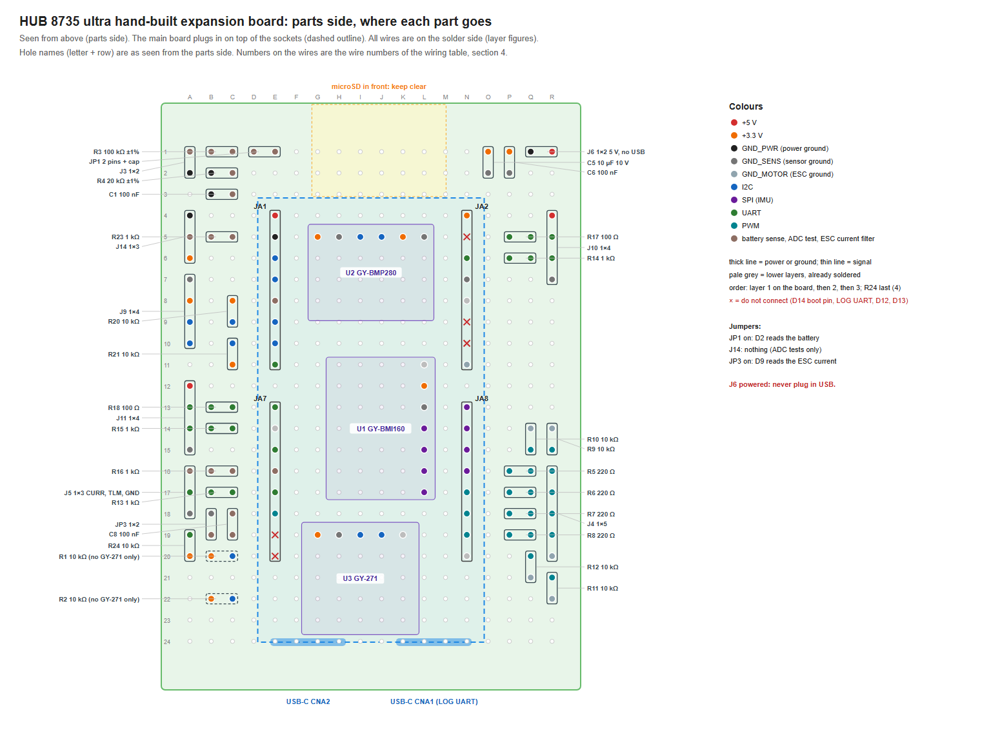

# Building the expansion board

[繁體中文](perfboard.zh-TW.md)

The expansion board of board type `hub8735ultra-expansion` is hand-built on a 50 × 70 mm perfboard. This page gives which holes each part goes in, the route of every wire, the soldering order and the checks before the development board goes on. The connectors and their wiring are in the [expansion board README](README.md#pinout).

- The development board (HUB 8735 ultra) plugs into two female header strips, the three sensor modules sit under it, and the headers and resistors are around the edge.
- **Every wire is on the solder side**, stacked in 4 layers: the parts side holds the sockets and modules, so no wires can run there; the wire is insulated, so stacking is fine. Within a layer no two wires cross or share a hole, and a higher layer lies on top of the lower ones. Layer 1 has 53 wires, layer 2 19, layer 3 11 and layer 4 2 (R24). A wire that lies over another net's joint is always on a higher layer than every wire soldered to that joint, so the joint is finished before anything lies on it; 18 joints are crossed this way.
- Wires follow the rows and columns of holes, and every wire has a number in the figures and in section 4.
- Positions are a suggestion: move a part if yours does not fit, but keep the connections.
- **Power**: J6 takes 5 V (for example from a BEC), straight to the development board's VIN with no reverse-polarity protection. The development board's VIN is 4.75–5.25 V, and the VBUS of both USB-C connectors is on VIN too: **while J6 is powered, plug in neither USB-C.** Mark J6 on the board.

## 1. Parts

| Refs | Value | What | Qty | Note |
|---|---|---|---|---|
| U1 | GY-BMI160 | GY module | 1 |  |
| U2 | GY-BMP280 (silkscreen GY-BME/PMP280) | GY module | 1 |  |
| U3 | GY-271 (QMC5883L) | GY module | 1 |  |
| R1, R2 | 10 kΩ | through-hole resistor | 2 | only without a GY-271 |
| R3 | 100 kΩ ±1% | through-hole resistor | 1 |  |
| R4 | 20 kΩ ±1% | through-hole resistor | 1 |  |
| R5–R8 | 220 Ω | through-hole resistor | 4 |  |
| R9–R12, R20, R21, R24 | 10 kΩ | through-hole resistor | 7 |  |
| R13–R16 | 1 kΩ | through-hole resistor | 4 |  |
| R17, R18 | 100 Ω | through-hole resistor | 2 |  |
| R23 | 1 kΩ | through-hole resistor | 1 |  |
| C1, C6, C8 | 100 nF | ceramic capacitor, 10 V or more | 3 |  |
| C5 | 10 µF 10 V | ceramic capacitor, 10 V or more | 1 |  |
| J1 | HUB 8735 ultra | female header strip, 2.54 mm, 8.5 mm tall: one strip of 17 per side (cut from 1×20 or 1×40; the hole in row 12 is unused) | 2 |  |
| J3, J6 | 1×2 | male pin header, 2.54 mm, straight | 2 |  |
| J4 | 1×5 | male pin header, 2.54 mm, straight | 1 |  |
| J5 | 1×3 | male pin header, 2.54 mm, straight | 1 |  |
| J9–J11 | 1×4 | male pin header, 2.54 mm, straight | 3 |  |
| J14 | 1×3 | male pin header, 2.54 mm, straight | 1 |  |
| JP1 | 2 pins + cap | 1×2 pin header and a jumper cap | 1 |  |
| JP3 | 1×2 | male pin header 1×2, 2.54 mm, straight, with a jumper cap | 1 |  |

- A 50 × 70 mm perfboard (18 × 24 holes), two jumper caps (JP1, JP3), insulated wire (AWG 28–30; AWG 24–26 for the J6 power wires), heat-shrink.
- Without a GY-271, fit R1 and R2 (the pull-ups of I²C bus 1).

## 2. Development board pins

Seen from the development board's component side, USB-C down.

| Pin | Name | Net | Goes to |
|---|---|---|---|
| JA1.1 | 5V/VIN | `+5V` | J10.1, J11.1, J6.1 |
| JA1.2 | GND | `GND_PWR` | J3.2, R4.2, C1.2, J14.1, J6.2 |
| JA1.3 | D0/I2C1_SDA | `I2C1_SDA` | U2.4, U3.4, R1.2 |
| JA1.4 | D1/I2C1_SCL | `I2C1_SCL` | U2.3, U3.3, R2.2 |
| JA1.5 | D2/ADC0 | `VBAT_ADC` | JP1.2, R23.1 |
| JA1.6 | D3/I2C2_SDA | `I2C2_SDA` | R20.2, J9.3 |
| JA1.7 | D4/I2C2_SCL | `I2C2_SCL` | R21.2, J9.4 |
| JA1.8 | D5/UART3_RX | `SERIAL4_RX` | R15.1 |
| JA7.1 | D6/UART3_TX | `SERIAL4_TX` | R18.1 |
| JA7.2 | D7 | — | not connected |
| JA7.3 | D8/UART2_TX | `SERIAL1_TX` | R17.1 |
| JA7.4 | D9/analog pin 9 | `ESC_CURR` | R16.1, C8.1 |
| JA7.5 | D10/SERIAL3_RX | `SERIAL3_RX` | R13.1 |
| JA7.6 | D11/PWM1 | `PWM1` | R5.1 |
| JA7.7 | D12 | — | do not connect: upgrade button |
| JA7.8 | D13 | — | do not connect: fill light |
| JA2.1 | 3.3V | `+3V3` | U1.2, U2.1, U2.5, U3.1, R1.1, R2.1, C5.1, C6.1, J9.2, R20.1, R21.1, R24.1, J14.3 |
| JA2.2 | D14/BOOT | — | **do not connect: boot-mode pin, next to 3.3V** |
| JA2.3 | D15/UART2_RX | `SERIAL1_RX` | R14.1 |
| JA2.4 | GND | `GND_SENS` | U1.3, U2.2, U2.6, U3.2, J9.1, J5.3, J10.4, J11.4, C5.2, C6.2, JP3.2 |
| JA2.5 | VCC | — | second 5V (VIN) pin; this board uses JA1.1 |
| JA2.6 | D16/LOG_RX | — | do not connect: log UART RX |
| JA2.7 | D17/LOG_TX | — | do not connect: log UART TX |
| JA2.8 | GND | `GND_MOTOR` | J4.5, R9.2, R10.2, R11.2, R12.2 |
| JA8.1 | D18/SPI1_MISO | `SPI1_MISO` | U1.7 |
| JA8.2 | D19/SPI1_SCLK | `SPI1_SCLK` | U1.4 |
| JA8.3 | D20/SPI1_MOSI | `SPI1_MOSI` | U1.5 |
| JA8.4 | D21/SPI1_CS | `SPI1_CS` | U1.6 |
| JA8.5 | D22/PWM2 | `PWM2` | R6.1 |
| JA8.6 | D23/PWM3 | `PWM3` | R7.1 |
| JA8.7 | D24/PWM4 | `PWM4` | R8.1 |
| JA8.8 | SPK | — | spare (speaker output) |

The three grounds meet only at the development board's header pins: `GND_PWR` = JA1.2, `GND_SENS` = JA2.4, `GND_MOTOR` = JA2.8.

## 3. Placement

Solder side, one figure per layer (seen from below, so left and right are swapped): [layer 1](perfboard/solder-layer1.png), [layer 2](perfboard/solder-layer2.png), [layer 3](perfboard/solder-layer3.png), [layer 4](perfboard/solder-layer4.png).

- Sockets: left row in column E, right row in column N (9 holes apart), pin 1 in row 4. The modules sit under the development board.
- Headers sit in the outer columns (A, R) and the top rows, each with its resistors next to it in the same row as the development-board pin it goes to, so most signals are short straight wires. Nothing goes in front of the microSD slot (columns G–L, rows 1–3) or past the USB-C end, so the debug USB-C (CNA1) and the microSD slot stay free.
- Tall parts (pin headers, standing resistors) only where the development board is not above them. A standing resistor next to the development board's edge stands in the outer hole and bends its other lead into the inner one.
- PWM pull-downs: the wires to R10 and R11 pass over the next channel's solder joint (insulated wire).
- C5 (10 µF): if it is an electrolytic, its negative lead goes in the sensor-ground hole (see the parts-side figure).

## 4. Every wire

Holes are named column letter + row, as seen from the **parts side** (A–R left to right, row 1 at the microSD end). On the solder side the letters run R–A. Each wire follows the holes listed (start, corners, end). Where two holes are next to each other, a solder bridge or a bent lead is enough. Solder layer 1 first, then layer 2 on top of it, then layer 3, and layer 4 last. "Over joints" lists the other nets' solder joints the wire lies across.

| # | Layer | Net | From | To | Route | mm | Over joints |
|---|---|---|---|---|---|---|---|
| 1 | 1 | `+5V` | J11.1 A12 | JA1.1 (5V) E4 | A12→D12→D4→E4 | 30 |  |
| 2 | 1 | `+5V` | J10.1 R4 | JA1.1 (5V) E4 | R4→R3→E3→E4 | 38 |  |
| 3 | 1 | `+5V` | J6.1 R1 | J10.1 R4 | R1→R4 | 8 |  |
| 4 | 1 | `+3V3` | C6.1 P1 | C5.1 O1 | P1→O1 | 3 |  |
| 5 | 1 | `+3V3` | U2.5 K5 | JA2.1 (3.3V) N4 | K5→K4→N4 | 10 |  |
| 6 | 1 | `+3V3` | U2.1 G5 | U2.5 K5 | G5→G4→K4→K5 | 15 |  |
| 7 | 1 | `+3V3` | J9.2 A8 | J14.3 A6 | A8→B8→B6→A6 | 10 |  |
| 8 | 1 | `+3V3` | R20.1 C8 | J9.2 A8 | C8→A8 | 5 |  |
| 9 | 1 | `+3V3` | R21.1 C11 | R20.1 C8 | C11→B11→B8→C8 | 13 |  |
| 10 | 1 | `+3V3` | U1.2 L12 | U2.5 K5 | L12→K12→K5 | 20 |  |
| 11 | 1 | `+3V3` | U3.1 G19 | U1.2 L12 | G19→G12→L12 | 30 |  |
| 12 | 1 | `+3V3` (only with R1/R2) | R1.1 B20 | U3.1 G19 | B20→B21→G21→G19 | 20 |  |
| 13 | 1 | `+3V3` (only with R1/R2) | R2.1 B22 | R1.1 B20 | B22→B20 | 5 |  |
| 14 | 1 | `GND_PWR` | R4.2 B2 | C1.2 B3 | B2→B3 | 3 |  |
| 15 | 1 | `GND_PWR` | J3.2 A2 | R4.2 B2 | A2→B2 | 3 |  |
| 16 | 1 | `GND_PWR` | J14.1 A4 | J3.2 A2 | A4→A2 | 5 |  |
| 17 | 1 | `GND_SENS` | J10.4 R7 | JA2.4 (GND) N7 | R7→N7 | 10 |  |
| 18 | 1 | `GND_SENS` | U2.6 L5 | JA2.4 (GND) N7 | L5→L7→N7 | 10 |  |
| 19 | 1 | `GND_SENS` | C6.2 P2 | C5.2 O2 | P2→O2 | 3 |  |
| 20 | 1 | `GND_SENS` | U1.3 L13 | JA2.4 (GND) N7 | L13→M13→M7→N7 | 20 |  |
| 21 | 1 | `GND_SENS` | JP3.2 B18 | J5.3 A18 | B18→A18 | 3 |  |
| 22 | 1 | `GND_SENS` | U3.2 H19 | U1.3 L13 | H19→H13→L13 | 25 |  |
| 23 | 1 | `GND_MOTOR` | R10.2 Q14 | JA2.8 (GND) N11 | Q14→Q11→N11 | 15 |  |
| 24 | 1 | `GND_MOTOR` | R9.2 R14 | R10.2 Q14 | R14→Q14 | 3 |  |
| 25 | 1 | `GND_MOTOR` | R11.2 R22 | R10.2 Q14 | R22→O22→O14→Q14 | 33 |  |
| 26 | 1 | `GND_MOTOR` | R12.2 Q21 | R11.2 R22 | Q21→Q22→R22 | 5 |  |
| 27 | 1 | `ADC_TP` | J14.2 A5 | R23.2 B5 | A5→B5 | 3 |  |
| 28 | 1 | `CURR_FILT` | JP3.1 B19 | C8.2 C19 | B19→C19 | 3 |  |
| 29 | 1 | `I2C1_SCL` (only with R1/R2) | R2.2 C22 | U3.3 I19 | C22→I22→I19 | 23 |  |
| 30 | 1 | `I2C1_SDA` | U2.4 J5 | JA1.3 (D0) E6 | J5→J6→E6 | 15 |  |
| 31 | 1 | `PWM1_OUT` | J4.1 R16 | R5.2 Q16 | R16→Q16 | 3 |  |
| 32 | 1 | `PWM1_OUT` | R9.1 R15 | J4.1 R16 | R15→R16 | 3 |  |
| 33 | 1 | `PWM2_OUT` | J4.2 R17 | R6.2 Q17 | R17→Q17 | 3 |  |
| 34 | 1 | `PWM3_OUT` | J4.3 R18 | R7.2 Q18 | R18→Q18 | 3 |  |
| 35 | 1 | `PWM4_OUT` | J4.4 R19 | R8.2 Q19 | R19→Q19 | 3 |  |
| 36 | 1 | `PWM4_OUT` | R12.1 Q20 | R8.2 Q19 | Q20→Q19 | 3 |  |
| 37 | 1 | `SERIAL1_RX` | R14.1 P6 | JA2.3 (D15) N6 | P6→N6 | 5 |  |
| 38 | 1 | `SERIAL1_RX_IN` | J10.3 R6 | R14.2 Q6 | R6→Q6 | 3 |  |
| 39 | 1 | `SERIAL1_TX_OUT` | J10.2 R5 | R17.2 Q5 | R5→Q5 | 3 |  |
| 40 | 1 | `SERIAL3_RX_IN` | J5.2 A17 | R13.2 B17 | A17→B17 | 3 |  |
| 41 | 1 | `ESC_CURR` | R16.1 C16 | JA7.4 (D9) E16 | C16→E16 | 5 |  |
| 42 | 1 | `ESC_CURR` | C8.1 C18 | JA7.4 (D9) E16 | C18→D18→D16→E16 | 10 |  |
| 43 | 1 | `ESC_CURR_IN` | J5.1 A16 | R16.2 B16 | A16→B16 | 3 |  |
| 44 | 1 | `SERIAL4_RX_IN` | J11.3 A14 | R15.2 B14 | A14→B14 | 3 |  |
| 45 | 1 | `SERIAL4_TX` | R18.1 C13 | JA7.1 (D6) E13 | C13→E13 | 5 |  |
| 46 | 1 | `SERIAL4_TX_OUT` | J11.2 A13 | R18.2 B13 | A13→B13 | 3 |  |
| 47 | 1 | `SPI1_CS` | U1.6 L16 | JA8.4 (D21) N16 | L16→N16 | 5 |  |
| 48 | 1 | `SPI1_MOSI` | U1.5 L15 | JA8.3 (D20) N15 | L15→N15 | 5 |  |
| 49 | 1 | `SPI1_SCLK` | U1.4 L14 | JA8.2 (D19) N14 | L14→N14 | 5 |  |
| 50 | 1 | `VBAT_DIV` | JP1.1 D1 | R3.2 C1 | D1→C1 | 3 |  |
| 51 | 1 | `VBAT_DIV` | R4.1 C2 | R3.2 C1 | C2→C1 | 3 |  |
| 52 | 1 | `VBAT_DIV` | C1.1 C3 | R4.1 C2 | C3→C2 | 3 |  |
| 53 | 1 | `VBAT_SENSE` | R3.1 B1 | J3.1 A1 | B1→A1 | 3 |  |
| 54 | 2 | `+3V3` | C5.1 O1 | JA2.1 (3.3V) N4 | O1→N1→N4 | 10 |  |
| 55 | 2 | `+3V3` | J14.3 A6 | U2.1 G5 | A6→D6→D3→G3→G5 | 28 |  |
| 56 | 2 | `GND_SENS` | U2.2 H5 | U2.6 L5 | H5→H4→L4→L5 | 15 |  |
| 57 | 2 | `GND_SENS` | C5.2 O2 | JA2.4 (GND) N7 | O2→O7→N7 | 15 |  |
| 58 | 2 | `GND_SENS` | J9.1 A7 | U1.3 L13 | A7→D7→D21→H21→H13→L13 | 84 |  |
| 59 | 2 | `GND_SENS` | J11.4 A15 | J9.1 A7 | A15→D15→D7→A7 | 36 |  |
| 60 | 2 | `GND_SENS` | J5.3 A18 | J11.4 A15 | A18→A15 | 8 | A17, A16 |
| 61 | 2 | `GND_MOTOR` | J4.5 R20 | R9.2 R14 | R20→R14 | 15 | R19, R18, R17, R16, R15 |
| 62 | 2 | `I2C1_SCL` | U2.3 I5 | JA1.4 (D1) E7 | I5→I7→E7 | 15 |  |
| 63 | 2 | `I2C1_SDA` (only with R1/R2) | R1.2 C20 | U3.4 J19 | C20→C21→A21→A23→J23→J19 | 46 |  |
| 64 | 2 | `I2C2_SCL` | J9.4 A10 | R21.2 C10 | A10→C10 | 5 |  |
| 65 | 2 | `I2C2_SDA` | J9.3 A9 | R20.2 C9 | A9→C9 | 5 |  |
| 66 | 2 | `PWM2` | R6.1 P17 | JA8.5 (D22) N17 | P17→N17 | 5 |  |
| 67 | 2 | `PWM2_OUT` | R10.1 Q15 | R6.2 Q17 | Q15→Q17 | 5 | Q16 |
| 68 | 2 | `PWM3` | R7.1 P18 | JA8.6 (D23) N18 | P18→N18 | 5 |  |
| 69 | 2 | `PWM3_OUT` | R11.1 R21 | R7.2 Q18 | R21→R23→Q23→Q18 | 20 | R22, Q21, Q20, Q19 |
| 70 | 2 | `PWM4` | R8.1 P19 | JA8.7 (D24) N19 | P19→N19 | 5 |  |
| 71 | 2 | `SPI1_MISO` | U1.7 L17 | JA8.1 (D18) N13 | L17→M17→M13→N13 | 15 |  |
| 72 | 2 | `VBAT_ADC` | JP1.2 E1 | JA1.5 (D2) E8 | E1→M1→M8→E8 | 58 |  |
| 73 | 3 | `GND_PWR` | C1.2 B3 | JA1.2 (GND) E5 | B3→B4→D4→D5→E5 | 13 |  |
| 74 | 3 | `GND_PWR` | J6.2 Q1 | JA1.2 (GND) E5 | Q1→F1→F5→E5 | 41 | P1, O1 |
| 75 | 3 | `I2C1_SCL` | U3.3 I19 | U2.3 I5 | I19→I5 | 36 |  |
| 76 | 3 | `I2C1_SDA` | U3.4 J19 | U2.4 J5 | J19→J5 | 36 |  |
| 77 | 3 | `I2C2_SCL` | R21.2 C10 | JA1.7 (D4) E10 | C10→E10 | 5 |  |
| 78 | 3 | `I2C2_SDA` | R20.2 C9 | JA1.6 (D3) E9 | C9→E9 | 5 |  |
| 79 | 3 | `PWM1` | R5.1 P16 | JA7.6 (D11) E18 | P16→O16→O21→F21→F18→E18 | 48 |  |
| 80 | 3 | `SERIAL1_TX` | R17.1 P5 | JA7.3 (D8) E15 | P5→P3→G3→G15→E15 | 64 | G5 |
| 81 | 3 | `SERIAL3_RX` | R13.1 C17 | JA7.5 (D10) E17 | C17→E17 | 5 |  |
| 82 | 3 | `SERIAL4_RX` | R15.1 C14 | JA1.8 (D5) E11 | C14→D14→D11→E11 | 13 |  |
| 83 | 3 | `VBAT_ADC` | R23.1 C5 | JA1.5 (D2) E8 | C5→C6→D6→D8→E8 | 13 |  |
| 84 | 4 | `+3V3` | R24.1 A20 | U3.1 G19 | A20→A21→G21→G19 | 23 |  |
| 85 | 4 | `SERIAL3_RX_IN` | R24.2 A19 | R13.2 B17 | A19→D19→D17→B17 | 18 | B19, C19, C17 |

85 wires, numbered in soldering order, layer by layer; within a layer, power and ground first, and a wire that crosses joints comes after every wire that ends on those joints. Wires marked "only with R1/R2" are soldered only when there is no GY-271.

## 5. Soldering steps

1. Before: unplug USB and power; keep the development board off for now.
2. Sockets: two full female strips in columns E and N, pin 1 in row 4. Plug the development board in once to check the fit, then take it off again.
3. Modules: GY-BMP280 in G5–L5, GY-BMI160 in L11–L17, GY-271 in G19–K19; the GY-BMP280 and GY-271 bodies toward the USB-C end, the GY-BMI160 toward the left.
4. Resistors, capacitors, headers, JP1 and JP3 in the positions of the parts-side figure.
5. Turn the board over and lay the wires layer by layer, in the order of section 4: all of layer 1 flat on the board, then layer 2 on top of it, then layer 3, each in number order. Insulated wire for anything longer than two holes; a wire listed with "over joints" lies across those joints, which are already soldered by then: do not heat them again once it is on.
6. Last, R24 (10 kΩ pull-up on J5 pin 2): stand it in A19 (pin 2) and A20 (pin 1), then lay the 2 layer-4 wires in section 4. No other wire runs through A19 or A20.
7. JA2.2 (D14, boot-mode pin) is right next to 3.3 V (JA2.1): no wire, no solder on it. Also leave JA2.6, JA2.7 (LOG UART), JA7.7 and JA7.8 alone.
8. J6: + is R1, − is Q1. Write "5 V, NO USB WHEN POWERED" next to it with a marker or a tape label. A plain 2-pin header has no polarity key, and reversed power goes straight into the development board; if the power lead has a keyed plug (for example JST-XH 2-pin), fit the matching socket instead, + on R1.
9. Jumpers: JP1 on (D2 reads the battery voltage); JP3 on (D9 reads the ESC current); nothing on J14.
10. ESC wires: ESC Curr → J5 pin 1; if the ESC has a telemetry wire, TLM → J5 pin 2; nothing on J5 pin 3. ESC M1–M4 → J4 pins 1–4, and the ESC's ground only to J4 pin 5. Battery voltage: ESC VBAT → J3 pin 1, nothing on J3 pin 2.

## 6. Checks before plugging in the development board

With a meter, development board off, nothing powered:

1. 3.3 V (JA2.1) to each ground (JA1.2, JA2.4, JA2.8): not shorted.
2. 5 V (JA1.1) to ground: not shorted; 5 V to 3.3 V: not connected.
3. J6 +: connected to JA1.1; J6 −: connected to JA1.2.
4. Before a BEC goes on J6 for the first time: with no load on the BEC, its output reads 4.75–5.25 V, and the lead that goes to R1 (J6 +) is the positive one (the meter's red lead on it reads a positive voltage). Check it again for every other BEC.
5. JA2.2 (D14) to anything: not connected.
6. JP1 off: D2 (JA1.5) to the divider node (R4) not connected; JP1 on: connected.
7. J5 pin 1 to D9 (JA7.4): about 1 kΩ (R16). With JP3 on, C8's leg on JP3 to sensor ground (JA2.4): connected.
8. J5 pin 2 to 3.3 V (JA2.1): about 10 kΩ (R24).
9. Each wire in section 4: continuity end to end (tick them off).

Then plug in the development board (component side up, USB-C toward row 24). Power it either from USB or from J6, never both.

## 7. After it is built

- Orientation: do the gravity test and the turn test under [Wiring Diagram in the expansion board README](README.md#wiring-diagram).
- J9 (I²C bus 2): the board type enables this bus; a device on J9 needs its line in `hwdef.dat`.
- ADC on J14: take JP1 off first, then put a cap on J14 pins 1–2 (TP to GND) or 2–3 (TP to 3V3); for the mid point, plug two 1 kΩ across pins 3–2 and 2–1. During a measurement session, reboot with JP1 off and nothing on J14 (D2 sees only the open 1 kΩ); in normal use JP1 stays on. 3V3 is never next to GND.
- Pin 1 (5V) of J10 and J11 is the same VIN as J6.
- ESC current: the D9 analog input reads up to 3.3 V full scale. The MicoAir Bluejay-4IN1-33A gives 12.75 mV/A, 1.68 V at 4 × 33 A. For an ESC whose Curr goes above 3.3 V at full current, solder a 10 kΩ across C8's two legs: with R16 it divides by 0.91, and `BATT_AMP_PERVLT` changes with it.
- ESC telemetry: R24 pulls J5 pin 2 to 3.3 V. For an ESC with a 5 V TLM output, measure its high level before connecting; above 3.3 V, add a divider or a level shifter.
- J4: each channel has 220 Ω in series and a 10 kΩ pull-down to motor ground.
- GPS on J10 and RC receiver on J11 (Pixhawk pin order: 5V, TX, RX, GND); a GPS compass goes on J9.
- The status of each connector is under [Status in the expansion board README](README.md#status).
