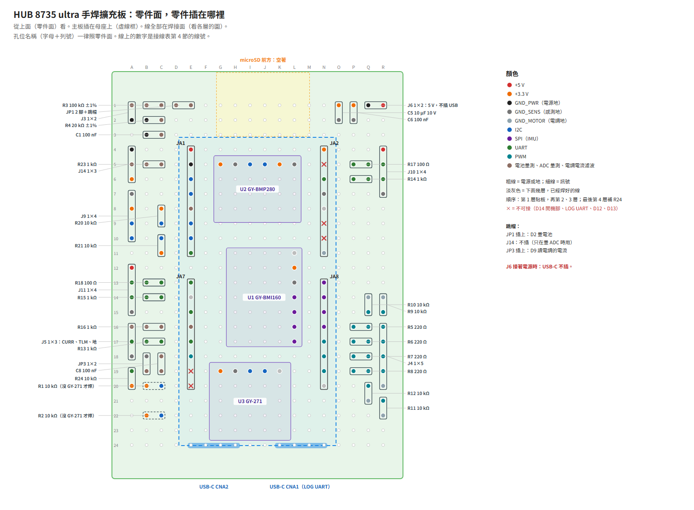

# 擴充板手焊說明

[English](perfboard.md)

板型 `hub8735ultra-expansion` 的擴充板，手焊在 50 × 70 mm 的洞洞板上。這份寫每個零件插在哪些孔、每一條線怎麼走、焊接的順序，以及插開發板之前的檢查。接點與接法見[擴充板 README](README.zh-TW.md#接腳)。

- 開發板（HUB 8735 ultra）插在兩條母座上，三個感測器模組在開發板底下，排針與電阻在外圍。
- **線全部在焊接面**，分 4 層疊：零件面有母座和模組，拉不了線；線有絕緣皮，疊上去沒關係。同一層裡的線不交叉、不共用孔，上一層壓在下一層上面。第 1 層 53 條、第 2 層 19 條、第 3 層 11 條、第 4 層 2 條（R24）。壓過別的網焊點的線，一定在焊在那個焊點的所有線的上層：焊點先焊好，才有線壓上去；這樣壓過的焊點共 18 個。
- 線沿著孔的行列走，每條線在圖上和第 4 節都有編號。
- 位置是建議；零件放不下可以挪，接法照表不變。
- **電源**：J6 接 5 V（例如 BEC），直接接開發板的 VIN，中間沒有防反接。開發板的 VIN 是 4.75～5.25 V，兩個 USB-C 的 VBUS 也接在 VIN 上：**J6 接著電源時，USB-C 都不插。** J6 旁邊做記號。

## 1. 零件

| 位號 | 值 | 規格 | 數量 | 備註 |
|---|---|---|---|---|
| U1 | GY-BMI160 | GY 模組 | 1 |  |
| U2 | GY-BMP280（絲印 GY-BME/PMP280） | GY 模組 | 1 |  |
| U3 | GY-271（QMC5883L） | GY 模組 | 1 |  |
| R1、R2 | 10 kΩ | 插件電阻 | 2 | 沒裝 GY-271 才焊 |
| R3 | 100 kΩ ±1% | 插件電阻 | 1 |  |
| R4 | 20 kΩ ±1% | 插件電阻 | 1 |  |
| R5–R8 | 220 Ω | 插件電阻 | 4 |  |
| R9–R12、R20、R21、R24 | 10 kΩ | 插件電阻 | 7 |  |
| R13–R16 | 1 kΩ | 插件電阻 | 4 |  |
| R17、R18 | 100 Ω | 插件電阻 | 2 |  |
| R23 | 1 kΩ | 插件電阻 | 1 |  |
| C1、C6、C8 | 100 nF | 陶瓷電容，耐壓 10 V 以上 | 3 |  |
| C5 | 10 µF 10 V | 陶瓷電容，耐壓 10 V 以上 | 1 |  |
| J1 | HUB 8735 ultra | 2.54 mm 單排母座，高 8.5 mm：每邊一條 17 孔（從 1×20 或 1×40 剪；第 12 列那一孔不用） | 2 |  |
| J3、J6 | 1×2 | 2.54 mm 直排針 | 2 |  |
| J4 | 1×5 | 2.54 mm 直排針 | 1 |  |
| J5 | 1×3 | 2.54 mm 直排針 | 1 |  |
| J9–J11 | 1×4 | 2.54 mm 直排針 | 3 |  |
| J14 | 1×3 | 2.54 mm 直排針 | 1 |  |
| JP1 | 2 腳＋跳帽 | 2.54 mm 1×2 排針加跳帽 | 1 |  |
| JP3 | 1×2 | 2.54 mm 1×2 直排針加跳帽 | 1 |  |

- 50 × 70 mm 洞洞板（18 × 24 孔）、跳帽 2 個（JP1、JP3）、有絕緣皮的細線（AWG 28～30；J6 的電源線用 AWG 24～26）、熱縮套管。
- 沒裝 GY-271 時，改焊 R1、R2（I²C 匯流排 1 的上拉）。

## 2. 開發板每支腳接什麼

從開發板元件面看、USB-C 朝下。

| 排針腳 | 名稱 | 網 | 接到 |
|---|---|---|---|
| JA1.1 | 5V/VIN | `+5V` | J10.1, J11.1, J6.1 |
| JA1.2 | GND | `GND_PWR` | J3.2, R4.2, C1.2, J14.1, J6.2 |
| JA1.3 | D0/I2C1_SDA | `I2C1_SDA` | U2.4, U3.4, R1.2 |
| JA1.4 | D1/I2C1_SCL | `I2C1_SCL` | U2.3, U3.3, R2.2 |
| JA1.5 | D2/ADC0 | `VBAT_ADC` | JP1.2, R23.1 |
| JA1.6 | D3/I2C2_SDA | `I2C2_SDA` | R20.2, J9.3 |
| JA1.7 | D4/I2C2_SCL | `I2C2_SCL` | R21.2, J9.4 |
| JA1.8 | D5/UART3_RX | `SERIAL4_RX` | R15.1 |
| JA7.1 | D6/UART3_TX | `SERIAL4_TX` | R18.1 |
| JA7.2 | D7 | — | 不接 |
| JA7.3 | D8/UART2_TX | `SERIAL1_TX` | R17.1 |
| JA7.4 | D9／類比腳 9 | `ESC_CURR` | R16.1, C8.1 |
| JA7.5 | D10/SERIAL3_RX | `SERIAL3_RX` | R13.1 |
| JA7.6 | D11/PWM1 | `PWM1` | R5.1 |
| JA7.7 | D12 | — | 勿接：upgrade 鍵 |
| JA7.8 | D13 | — | 勿接：補光燈 |
| JA2.1 | 3.3V | `+3V3` | U1.2, U2.1, U2.5, U3.1, R1.1, R2.1, C5.1, C6.1, J9.2, R20.1, R21.1, R24.1, J14.3 |
| JA2.2 | D14/BOOT | — | **勿接：開機模式腳，緊鄰 3.3V** |
| JA2.3 | D15/UART2_RX | `SERIAL1_RX` | R14.1 |
| JA2.4 | GND | `GND_SENS` | U1.3, U2.2, U2.6, U3.2, J9.1, J5.3, J10.4, J11.4, C5.2, C6.2, JP3.2 |
| JA2.5 | VCC | — | 第二支 5V（VIN）；本板用 JA1.1 |
| JA2.6 | D16/LOG_RX | — | 勿接：LOG UART RX |
| JA2.7 | D17/LOG_TX | — | 勿接：LOG UART TX |
| JA2.8 | GND | `GND_MOTOR` | J4.5, R9.2, R10.2, R11.2, R12.2 |
| JA8.1 | D18/SPI1_MISO | `SPI1_MISO` | U1.7 |
| JA8.2 | D19/SPI1_SCLK | `SPI1_SCLK` | U1.4 |
| JA8.3 | D20/SPI1_MOSI | `SPI1_MOSI` | U1.5 |
| JA8.4 | D21/SPI1_CS | `SPI1_CS` | U1.6 |
| JA8.5 | D22/PWM2 | `PWM2` | R6.1 |
| JA8.6 | D23/PWM3 | `PWM3` | R7.1 |
| JA8.7 | D24/PWM4 | `PWM4` | R8.1 |
| JA8.8 | SPK | — | 空著（喇叭輸出） |

三組地只在開發板的排針上相接：`GND_PWR`＝JA1.2，`GND_SENS`＝JA2.4，`GND_MOTOR`＝JA2.8。

## 3. 擺放

焊接面每層一張（從底下看，左右相反）：[第 1 層](perfboard/solder-layer1.zh-TW.png)、[第 2 層](perfboard/solder-layer2.zh-TW.png)、[第 3 層](perfboard/solder-layer3.zh-TW.png)、[第 4 層](perfboard/solder-layer4.zh-TW.png)。

- 母座：左排 E 欄、右排 N 欄（相隔 9 格），第 1 腳在第 4 列。三個模組放在開發板底下。
- 排針放在最外欄（A、R）與上方幾列，電阻緊靠在旁邊、和要接的開發板腳同一列，大部分訊號是一段直線。microSD 前面（G～L 欄、第 1～3 列）和 USB-C 那一端外面都不放東西，除錯用的 USB-C（CNA1）和 microSD 都不會被擋。
- 高的零件（排針、直立電阻）只放在開發板不會壓到的位置。靠開發板邊的直立電阻，本體站在外側那一孔，另一腳彎下來插內側那一孔。
- PWM 的下拉：接 R10、R11 的線要跨過鄰路的焊點（用絕緣線）。
- C5（10 µF）若用電解電容：負極（短腳）插感測地那一孔（見零件面的圖）。

## 4. 每一條線

孔位寫成「欄字母＋列號」，從**零件面**看（A～R 由左到右，第 1 列在 microSD 端）；從焊接面看字母順序是 R～A。每條線照列出的孔走（起點、轉角、終點）。兩孔相鄰時，用焊錫橋或彎過去的零件腳就可以。先焊第 1 層，再把第 2 層疊在上面，然後第 3 層，最後第 4 層。「壓過焊點」列的是這條線要橫躺壓過的別的網的焊點。

| # | 層 | 網 | 一端 | 另一端 | 怎麼走 | mm | 壓過焊點 |
|---|---|---|---|---|---|---|---|
| 1 | 1 | `+5V` | J11.1 A12 | JA1.1 (5V) E4 | A12→D12→D4→E4 | 30 |  |
| 2 | 1 | `+5V` | J10.1 R4 | JA1.1 (5V) E4 | R4→R3→E3→E4 | 38 |  |
| 3 | 1 | `+5V` | J6.1 R1 | J10.1 R4 | R1→R4 | 8 |  |
| 4 | 1 | `+3V3` | C6.1 P1 | C5.1 O1 | P1→O1 | 3 |  |
| 5 | 1 | `+3V3` | U2.5 K5 | JA2.1 (3.3V) N4 | K5→K4→N4 | 10 |  |
| 6 | 1 | `+3V3` | U2.1 G5 | U2.5 K5 | G5→G4→K4→K5 | 15 |  |
| 7 | 1 | `+3V3` | J9.2 A8 | J14.3 A6 | A8→B8→B6→A6 | 10 |  |
| 8 | 1 | `+3V3` | R20.1 C8 | J9.2 A8 | C8→A8 | 5 |  |
| 9 | 1 | `+3V3` | R21.1 C11 | R20.1 C8 | C11→B11→B8→C8 | 13 |  |
| 10 | 1 | `+3V3` | U1.2 L12 | U2.5 K5 | L12→K12→K5 | 20 |  |
| 11 | 1 | `+3V3` | U3.1 G19 | U1.2 L12 | G19→G12→L12 | 30 |  |
| 12 | 1 | `+3V3`（焊 R1、R2 才要） | R1.1 B20 | U3.1 G19 | B20→B21→G21→G19 | 20 |  |
| 13 | 1 | `+3V3`（焊 R1、R2 才要） | R2.1 B22 | R1.1 B20 | B22→B20 | 5 |  |
| 14 | 1 | `GND_PWR` | R4.2 B2 | C1.2 B3 | B2→B3 | 3 |  |
| 15 | 1 | `GND_PWR` | J3.2 A2 | R4.2 B2 | A2→B2 | 3 |  |
| 16 | 1 | `GND_PWR` | J14.1 A4 | J3.2 A2 | A4→A2 | 5 |  |
| 17 | 1 | `GND_SENS` | J10.4 R7 | JA2.4 (GND) N7 | R7→N7 | 10 |  |
| 18 | 1 | `GND_SENS` | U2.6 L5 | JA2.4 (GND) N7 | L5→L7→N7 | 10 |  |
| 19 | 1 | `GND_SENS` | C6.2 P2 | C5.2 O2 | P2→O2 | 3 |  |
| 20 | 1 | `GND_SENS` | U1.3 L13 | JA2.4 (GND) N7 | L13→M13→M7→N7 | 20 |  |
| 21 | 1 | `GND_SENS` | JP3.2 B18 | J5.3 A18 | B18→A18 | 3 |  |
| 22 | 1 | `GND_SENS` | U3.2 H19 | U1.3 L13 | H19→H13→L13 | 25 |  |
| 23 | 1 | `GND_MOTOR` | R10.2 Q14 | JA2.8 (GND) N11 | Q14→Q11→N11 | 15 |  |
| 24 | 1 | `GND_MOTOR` | R9.2 R14 | R10.2 Q14 | R14→Q14 | 3 |  |
| 25 | 1 | `GND_MOTOR` | R11.2 R22 | R10.2 Q14 | R22→O22→O14→Q14 | 33 |  |
| 26 | 1 | `GND_MOTOR` | R12.2 Q21 | R11.2 R22 | Q21→Q22→R22 | 5 |  |
| 27 | 1 | `ADC_TP` | J14.2 A5 | R23.2 B5 | A5→B5 | 3 |  |
| 28 | 1 | `CURR_FILT` | JP3.1 B19 | C8.2 C19 | B19→C19 | 3 |  |
| 29 | 1 | `I2C1_SCL`（焊 R1、R2 才要） | R2.2 C22 | U3.3 I19 | C22→I22→I19 | 23 |  |
| 30 | 1 | `I2C1_SDA` | U2.4 J5 | JA1.3 (D0) E6 | J5→J6→E6 | 15 |  |
| 31 | 1 | `PWM1_OUT` | J4.1 R16 | R5.2 Q16 | R16→Q16 | 3 |  |
| 32 | 1 | `PWM1_OUT` | R9.1 R15 | J4.1 R16 | R15→R16 | 3 |  |
| 33 | 1 | `PWM2_OUT` | J4.2 R17 | R6.2 Q17 | R17→Q17 | 3 |  |
| 34 | 1 | `PWM3_OUT` | J4.3 R18 | R7.2 Q18 | R18→Q18 | 3 |  |
| 35 | 1 | `PWM4_OUT` | J4.4 R19 | R8.2 Q19 | R19→Q19 | 3 |  |
| 36 | 1 | `PWM4_OUT` | R12.1 Q20 | R8.2 Q19 | Q20→Q19 | 3 |  |
| 37 | 1 | `SERIAL1_RX` | R14.1 P6 | JA2.3 (D15) N6 | P6→N6 | 5 |  |
| 38 | 1 | `SERIAL1_RX_IN` | J10.3 R6 | R14.2 Q6 | R6→Q6 | 3 |  |
| 39 | 1 | `SERIAL1_TX_OUT` | J10.2 R5 | R17.2 Q5 | R5→Q5 | 3 |  |
| 40 | 1 | `SERIAL3_RX_IN` | J5.2 A17 | R13.2 B17 | A17→B17 | 3 |  |
| 41 | 1 | `ESC_CURR` | R16.1 C16 | JA7.4 (D9) E16 | C16→E16 | 5 |  |
| 42 | 1 | `ESC_CURR` | C8.1 C18 | JA7.4 (D9) E16 | C18→D18→D16→E16 | 10 |  |
| 43 | 1 | `ESC_CURR_IN` | J5.1 A16 | R16.2 B16 | A16→B16 | 3 |  |
| 44 | 1 | `SERIAL4_RX_IN` | J11.3 A14 | R15.2 B14 | A14→B14 | 3 |  |
| 45 | 1 | `SERIAL4_TX` | R18.1 C13 | JA7.1 (D6) E13 | C13→E13 | 5 |  |
| 46 | 1 | `SERIAL4_TX_OUT` | J11.2 A13 | R18.2 B13 | A13→B13 | 3 |  |
| 47 | 1 | `SPI1_CS` | U1.6 L16 | JA8.4 (D21) N16 | L16→N16 | 5 |  |
| 48 | 1 | `SPI1_MOSI` | U1.5 L15 | JA8.3 (D20) N15 | L15→N15 | 5 |  |
| 49 | 1 | `SPI1_SCLK` | U1.4 L14 | JA8.2 (D19) N14 | L14→N14 | 5 |  |
| 50 | 1 | `VBAT_DIV` | JP1.1 D1 | R3.2 C1 | D1→C1 | 3 |  |
| 51 | 1 | `VBAT_DIV` | R4.1 C2 | R3.2 C1 | C2→C1 | 3 |  |
| 52 | 1 | `VBAT_DIV` | C1.1 C3 | R4.1 C2 | C3→C2 | 3 |  |
| 53 | 1 | `VBAT_SENSE` | R3.1 B1 | J3.1 A1 | B1→A1 | 3 |  |
| 54 | 2 | `+3V3` | C5.1 O1 | JA2.1 (3.3V) N4 | O1→N1→N4 | 10 |  |
| 55 | 2 | `+3V3` | J14.3 A6 | U2.1 G5 | A6→D6→D3→G3→G5 | 28 |  |
| 56 | 2 | `GND_SENS` | U2.2 H5 | U2.6 L5 | H5→H4→L4→L5 | 15 |  |
| 57 | 2 | `GND_SENS` | C5.2 O2 | JA2.4 (GND) N7 | O2→O7→N7 | 15 |  |
| 58 | 2 | `GND_SENS` | J9.1 A7 | U1.3 L13 | A7→D7→D21→H21→H13→L13 | 84 |  |
| 59 | 2 | `GND_SENS` | J11.4 A15 | J9.1 A7 | A15→D15→D7→A7 | 36 |  |
| 60 | 2 | `GND_SENS` | J5.3 A18 | J11.4 A15 | A18→A15 | 8 | A17、A16 |
| 61 | 2 | `GND_MOTOR` | J4.5 R20 | R9.2 R14 | R20→R14 | 15 | R19、R18、R17、R16、R15 |
| 62 | 2 | `I2C1_SCL` | U2.3 I5 | JA1.4 (D1) E7 | I5→I7→E7 | 15 |  |
| 63 | 2 | `I2C1_SDA`（焊 R1、R2 才要） | R1.2 C20 | U3.4 J19 | C20→C21→A21→A23→J23→J19 | 46 |  |
| 64 | 2 | `I2C2_SCL` | J9.4 A10 | R21.2 C10 | A10→C10 | 5 |  |
| 65 | 2 | `I2C2_SDA` | J9.3 A9 | R20.2 C9 | A9→C9 | 5 |  |
| 66 | 2 | `PWM2` | R6.1 P17 | JA8.5 (D22) N17 | P17→N17 | 5 |  |
| 67 | 2 | `PWM2_OUT` | R10.1 Q15 | R6.2 Q17 | Q15→Q17 | 5 | Q16 |
| 68 | 2 | `PWM3` | R7.1 P18 | JA8.6 (D23) N18 | P18→N18 | 5 |  |
| 69 | 2 | `PWM3_OUT` | R11.1 R21 | R7.2 Q18 | R21→R23→Q23→Q18 | 20 | R22、Q21、Q20、Q19 |
| 70 | 2 | `PWM4` | R8.1 P19 | JA8.7 (D24) N19 | P19→N19 | 5 |  |
| 71 | 2 | `SPI1_MISO` | U1.7 L17 | JA8.1 (D18) N13 | L17→M17→M13→N13 | 15 |  |
| 72 | 2 | `VBAT_ADC` | JP1.2 E1 | JA1.5 (D2) E8 | E1→M1→M8→E8 | 58 |  |
| 73 | 3 | `GND_PWR` | C1.2 B3 | JA1.2 (GND) E5 | B3→B4→D4→D5→E5 | 13 |  |
| 74 | 3 | `GND_PWR` | J6.2 Q1 | JA1.2 (GND) E5 | Q1→F1→F5→E5 | 41 | P1、O1 |
| 75 | 3 | `I2C1_SCL` | U3.3 I19 | U2.3 I5 | I19→I5 | 36 |  |
| 76 | 3 | `I2C1_SDA` | U3.4 J19 | U2.4 J5 | J19→J5 | 36 |  |
| 77 | 3 | `I2C2_SCL` | R21.2 C10 | JA1.7 (D4) E10 | C10→E10 | 5 |  |
| 78 | 3 | `I2C2_SDA` | R20.2 C9 | JA1.6 (D3) E9 | C9→E9 | 5 |  |
| 79 | 3 | `PWM1` | R5.1 P16 | JA7.6 (D11) E18 | P16→O16→O21→F21→F18→E18 | 48 |  |
| 80 | 3 | `SERIAL1_TX` | R17.1 P5 | JA7.3 (D8) E15 | P5→P3→G3→G15→E15 | 64 | G5 |
| 81 | 3 | `SERIAL3_RX` | R13.1 C17 | JA7.5 (D10) E17 | C17→E17 | 5 |  |
| 82 | 3 | `SERIAL4_RX` | R15.1 C14 | JA1.8 (D5) E11 | C14→D14→D11→E11 | 13 |  |
| 83 | 3 | `VBAT_ADC` | R23.1 C5 | JA1.5 (D2) E8 | C5→C6→D6→D8→E8 | 13 |  |
| 84 | 4 | `+3V3` | R24.1 A20 | U3.1 G19 | A20→A21→G21→G19 | 23 |  |
| 85 | 4 | `SERIAL3_RX_IN` | R24.2 A19 | R13.2 B17 | A19→D19→D17→B17 | 18 | B19、C19、C17 |

共 85 條線，照焊的順序編號，一層一層；同一層裡電源與地在前，壓過焊點的線排在線頭焊在那些焊點的線後面。標「焊 R1、R2 才要」的線，只在沒裝 GY-271 時焊。

## 5. 焊接步驟

1. 焊之前：拔掉 USB 與電源；開發板先不要插上。
2. 母座：E 欄、N 欄各一條整條母座，第 1 腳在第 4 列。焊好先插一次開發板確認插得上，再拔下來。
3. 模組：GY-BMP280 在 G5～L5、GY-BMI160 在 L11～L17、GY-271 在 G19～K19；GY-BMP280、GY-271 的本體往 USB-C 端，GY-BMI160 往左。
4. 電阻、電容、排針、JP1、JP3 照零件面圖的位置焊。
5. 翻到焊接面，照第 4 節的順序一層一層拉線：第 1 層全部貼著板子拉完，再拉第 2 層疊在上面，然後第 3 層。每層照編號順序。超過兩孔的一律用有絕緣皮的線；「壓過焊點」有列的線，橫躺壓過那幾個焊點，那時它們都已經焊好：壓上去之後，那幾個焊點不要再加熱。
6. 最後焊 R24（J5 第 2 腳的 10 kΩ 上拉）：直立插在 A19（第 2 腳）、A20（第 1 腳），再照第 4 節拉第 4 層的 2 條線。A19、A20 沒有別的線經過。
7. JA2.2（D14，開機模式腳）緊鄰 3.3 V（JA2.1）：不接線、不沾錫。JA2.6、JA2.7（LOG UART）、JA7.7、JA7.8 也不碰。
8. J6：R1 是正、Q1 是負。旁邊用奇異筆或標籤寫「5 V、接電源時不插 USB」。2 腳排針沒有防呆，反接會把反向電壓直接送進開發板；電源線若是有方向的插頭（例如 JST-XH 2P），J6 改焊配對的座，正極在 R1。
9. 跳帽：JP1 插上（D2 量電池電壓）；JP3 插上（D9 讀電調的電流）；J14 不插。
10. 電調的線：電調的 Curr → J5 第 1 腳；電調有遙測線時，TLM → J5 第 2 腳；J5 第 3 腳不接。電調的 M1～M4 → J4 第 1～4 腳，電調的地只接 J4 第 5 腳。電池電壓：電調的 VBAT → J3 第 1 腳，J3 第 2 腳不接。

## 6. 插開發板之前的檢查

用電錶，開發板不插、不通電：

1. 3.3 V（JA2.1）對三個地（JA1.2、JA2.4、JA2.8）：不短路。
2. 5 V（JA1.1）對地：不短路；5 V 對 3.3 V：不通。
3. J6 正：通到 JA1.1；J6 負：通到 JA1.2。
4. 第一次把 BEC 接上 J6 之前：BEC 先不接負載，量它的輸出在 4.75～5.25 V，而且要接到 R1（J6 正）的那一條是正的（紅棒在那一條讀到正電壓）。換一顆 BEC 就再量一次。
5. JA2.2（D14）對任何一點：不通。
6. JP1 拔掉時 D2（JA1.5）對分壓點（R4）不通；插上時通。
7. J5 第 1 腳對 D9（JA7.4）：約 1 kΩ（R16）。JP3 插上時，C8 接 JP3 那一腳對感測地（JA2.4）通。
8. J5 第 2 腳對 3.3 V（JA2.1）：約 10 kΩ（R24）。
9. 第 4 節每一條線兩端都通（逐條打勾）。

通過後插上開發板（元件面朝上、USB-C 朝第 24 列那一端）。供電用 USB 或 J6，兩個不同時接。

## 7. 焊好之後

- 方向：照[擴充板 README〈接線圖〉](README.zh-TW.md#接線圖)的重力測試與轉向測試確認。
- J9（I²C 匯流排 2）：板型已開這條匯流排，J9 上接的裝置要在 `hwdef.dat` 加它的那一行。
- J14 量 ADC：先拔 JP1，再在 J14 插第 1–2 腳（TP 接地）或第 2–3 腳（TP 接 3V3）的跳帽；要中點就插兩顆 1 kΩ，一顆跨第 3–2 腳、一顆跨第 2–1 腳。量的那段期間，重開機時 JP1 拔掉、J14 不插（D2 只連著空著的 1 kΩ）；平常 JP1 插著。3V3 不會和 GND 相鄰。
- J10、J11 的第 1 腳（5V）和 J6 是同一條 VIN。
- 電調電流：D9 的類比輸入滿刻度 3.3 V。MicoAir Bluejay-4IN1-33A 的電流輸出是 12.75 mV/A，4 × 33 A 時 1.68 V。換用滿電流時 Curr 會超過 3.3 V 的電調，在 C8 的兩支腳上並一顆 10 kΩ：和 R16 分壓成 ×0.91，`BATT_AMP_PERVLT` 照著改。
- 電調遙測：R24 把 J5 第 2 腳拉到 3.3 V。TLM 是 5 V 輸出的電調，接上前先量它的高電位，超過 3.3 V 就加分壓或準位轉換。
- J4：每一路串 220 Ω，並有 10 kΩ 下拉到馬達地。
- GPS 接 J10、遙控接收機接 J11（Pixhawk 腳序：5V、TX、RX、地）；GPS 上的羅盤接 J9。
- 各接點的現況見[擴充板 README〈現況〉](README.zh-TW.md#現況)。
