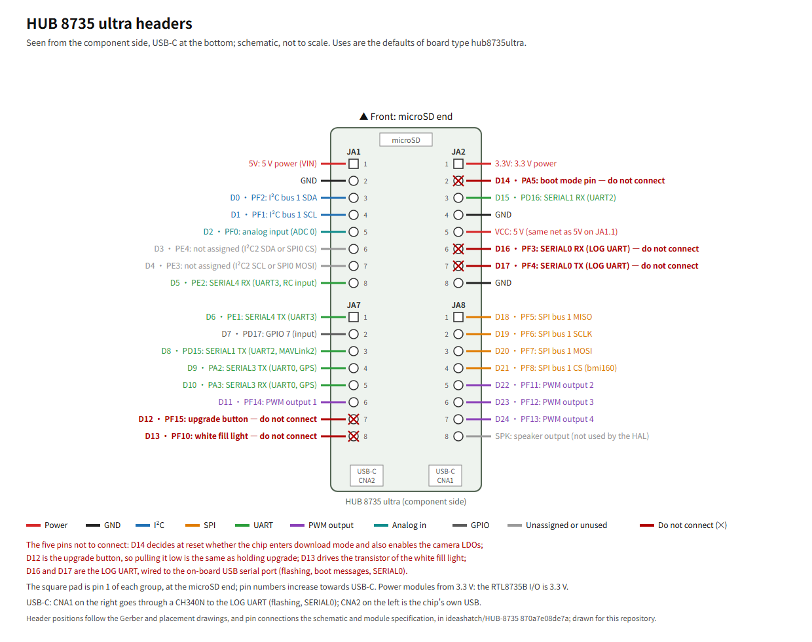

# HUB 8735 ultra

[繁體中文](README.zh-TW.md)

## Introduction

The HUB 8735 ultra is an RTL8735B development board from ideasHatch; the chip sits in the Winstec SM35B02 module on the board (schematic p.4). The board type `hub8735ultra` uses it as a flight controller: the header pins follow the variant in the vendor's Arduino package (`variant.cpp`, `variant.h`), the D numbers are the variant's `AMB_Dn`, and the GPIO logical numbers are the same as the D numbers. This port is developed and tested on this board.

The board has no IMU, barometer or compass (schematic, BOM); sensors connect to the header pins, see *Wiring Diagram*. The board's status is under [Status](#status).

## Specifications

- Processor: Realtek RTL8735B (Winstec SM35B02 module, schematic p.4); the vendor's Arduino board definition gives a CPU clock of 500 MHz (`boards.txt`).
- Memory: 16 MB external SPI flash (XT25F128B, schematic p.4, BOM); 128 MB DDR (linker script of the vendor's Arduino package 4.1.1).
- Wireless: Wi-Fi, see *Wi-Fi Module*.
- Storage: microSD slot, 4-bit SD (schematic p.7).
- USB: two USB-C connectors, CNA2 on the left and CNA1 on the right seen from the component side (Gerber). CNA1 goes through a CH340N to the chip's LOG UART, which carries flashing, boot messages and SERIAL0; CNA2 goes to the chip's own USB, which this port does not use (schematic p.9).
- Headers: two rows of 16 pins, 2.54 mm, the rows 22.86 mm apart (Gerber).
- Buttons: reset, upgrade (schematic p.4, p.8).
- LEDs: red (power, no control pin), green (D25), blue (D26), white fill light (D13) (schematic p.8).
- Other: a MIPI FPC connector for the camera and a digital microphone, which this port does not use.
- Power: 5 V (VIN), listed by the vendor as 4.75–5.25 V; I/O at 3.3 V (module specification p.4).
- Size: 53 × 27 mm (module specification p.4).

### Status

| Item | Status |
|---|---|
| Sensors wired as in *Wiring Diagram*, ground station over Wi-Fi (UDP) | Works (T2) |
| Flying a 3.5-inch quadcopter, with an expansion board ([`hub8735ultra-expansion`](../hub8735ultra-expansion/README.md)) and DShot300 | Works (T5) |
| Manual flashing through CNA1 | Works (T1) |
| `--upload` | Needs: one try on a board |
| SERIAL0: MAVLink on the USB serial port | Needs: one try on a board |
| SERIAL1, SERIAL3, SERIAL4 | Needs: one try on a board |
| GPS on SERIAL3 or SERIAL1 | Needs: one try with a GPS |
| RC receiver on SERIAL4 | Needs: one try with a receiver |
| PWM outputs 1–4: normal PWM, OneShot, OneShot125, brushed, DShot150, DShot600 | Needs: one try with ESCs or motors |
| Wi-Fi MAVLink over TCP | Needs: one try on a board |
| Joining the default Wi-Fi hotspot `ardupilot` | Needs: one try on a board |
| GPIOs: D7, the LEDs on D25 and D26 | Needs: one try on a board |
| Analog pins other than D2 | Needs: one try on a board |
| Battery voltage and current | Needs: calibration |
| Compass | Needs: orientation check and calibration |
| microSD card | Needs: one try with a card |
| I²C bus 2 on D3 and D4 | Needs: one try on a board |
| I²C airspeed sensor | Needs: one try on a board |

The status and notes of each HAL feature are in [Feature status](../../docs/feature-status.md).

## Where to Buy

The board is made by ideasHatch. The vendor's documents and Arduino package are in [ideashatch/HUB-8735](https://github.com/ideashatch/HUB-8735); the vendor documents used here give no shop link.

## Pinout



Vector version: [pinout.svg](pinout.svg).

Seen from the component side with USB-C at the bottom: the left row has JA1 above and JA7 below, the right row JA2 above and JA8 below, 8 pins each. Pin 1 of each group is the square pad at the microSD end, and the pin numbers increase towards the USB-C end (Gerber, placement drawing).

Power and ground:

- 5V (JA1.1) is VIN; VCC (JA2.5) goes to VIN through 0 Ω; the VBUS of both USB-C connectors also goes straight to VIN, with no diode or switch in between (schematic p.7, p.9).
- 3.3V (JA2.1) goes through 0 Ω to the output of the on-board 3.3 V regulator (schematic p.7, p.8).
- GND: JA1.2, JA2.4, JA2.8.

Pins that already have something connected on the board (marked ✕ in the figure):

| Pin | Header | Connected on the board to |
|---|---|---|
| D12 (PF15) | JA7.7 | Upgrade button: 10 kΩ pull-up to 3.3 V, grounded while pressed. The same node also pulls D14 (PA5) high through QA7, so pulling D12 low is the same as holding the upgrade button (schematic p.8) |
| D13 (PF10) | JA7.8 | The transistor that drives the white fill light (through 1 kΩ), 10 kΩ pull-down (schematic p.8) |
| D14 (PA5) | JA2.2 | Boot mode pin: its level at reset decides whether the chip enters download mode (schematic p.4); also the enable of the camera power LDOs. It sits next to 3.3V (JA2.1) |
| D16 (PF3) | JA2.6 | LOG UART RX, to TXD of the on-board CH340N (schematic p.9) |
| D17 (PF4) | JA2.7 | LOG UART TX, to RXD of the on-board CH340N (schematic p.9) |

SPK (JA8.8) is an audio output, not used by this port.

Buses:

| Bus | Pins | Notes |
|---|---|---|
| I²C bus 1 (SDK I2C1) | D0 (PF2, SDA, JA1.3), D1 (PF1, SCL, JA1.4) | 400 kHz, marked `external`. The board has no pull-up resistors on it (schematic p.7): it relies on the modules' own pull-ups, or on added ones |
| SPI bus 1 (SDK SPI1) | D18 (PF5, MISO, JA8.1), D19 (PF6, SCLK, JA8.2), D20 (PF7, MOSI, JA8.3), D21 (PF8, CS, JA8.4) | The CS of the SPI device `bmi160` is D21, mode 0, 1 MHz / 10 MHz |

- D3 (PE4, JA1.6) and D4 (PE3, JA1.7) are not assigned. An overlay can make them SDK I2C2 (D3 SDA, D4 SCL), for example `RTL8735B_I2CBUS 2 2 PIN_E4 PIN_E3 400000 external`; or the CS and MOSI of SPI0 (the SCLK and MISO of SPI0 are PE1 and PE2, so SERIAL4 is disabled first).
- I²C uses the SDK's numbering: `variant.h` labels PE4/PE3 as I2C0 and PA1/PA0 as I2C2, while the SDK's pin table has them the other way round (`component/mbed/targets/hal/rtl8735b/i2c_api.c`).

## Wiring Diagram

The board type itself has no sensors. Without a barometer, boot stops at `Config Error: Baro: unable to initialise driver`, and Wi-Fi then carries no MAVLink either. With the wiring below, and these sensor lines in an overlay on `hub8735ultra`, all three sensors are detected after boot, a ground station on Wi-Fi receives heartbeats and parameters, parameters are kept across reboots, and the attitude follows the board when its front or back end is lifted (T2 in [BOARD_TESTS.md](../../BOARD_TESTS.md), in Chinese).

| Sensor | Module | Connect to |
|---|---|---|
| IMU | GY-BMI160 | SPI bus 1: D18 (MISO, to SAO/SDO on the module), D19 (SCLK, to SCL), D20 (MOSI, to SDA), D21 (CS) |
| Barometer | BMP280 | I²C bus 1: D0 (SDA), D1 (SCL); SDO to GND (address 0x76), CSB to 3.3 V (selects I²C mode) |
| Compass | GY-271 (QMC5883L) | I²C bus 1: shares D0 and D1 with the BMP280 |

- The three modules connect to 3.3V (JA2.1) and GND. Pin names on the modules vary by maker; the silkscreen on the module you have is what counts.
- The board type [`hub8735ultra-expansion`](../hub8735ultra-expansion/README.md) has these three sensors on these pins. This wiring is built with it, without an overlay:

```bash
./waf configure --board hub8735ultra-expansion
./waf copter
```

- That board type also sets a battery monitor on D2 and D9 and a GPS on SERIAL1 (D8, D15). With nothing connected there, `BATT_MONITOR` and `GPS1_TYPE` are set to 0 in the ground station, followed by a reboot.

Mounting orientation:

- The IMU's `ROTATION_*` is found by testing; the silkscreen on the module is not enough. A GY-BMI160 with the component side up and `ROTATION_NONE` makes a level board read as upside down. The value in `hub8735ultra-expansion`, `ROTATION_ROLL_180_YAW_270`, was measured with the module component side up and the front at the end opposite the USB connectors.
- With a different mounting, test again: lifting the front of the board makes pitch positive, and with the board level, roll and pitch are close to 0.
- If the whole board is turned on the frame, the parameter `AHRS_ORIENTATION` covers it without a new build. An external compass's orientation is set with the parameter `COMPASS_ORIENT`.

Other sensors, pins and buses: [Describe your own board](../../docs/custom-boards.md).

## UART Mapping

| SERIALn | Chip UART | TX | RX | Default protocol | Notes |
|---|---|---|---|---|---|
| SERIAL0 | UART1 (LOG UART) | D17 (PF4, JA2.7) | D16 (PF3, JA2.6) | MAVLink2, 115200 baud | Through the on-board CH340N to USB-C CNA1 |
| SERIAL1 | UART2 | D8 (PD15, JA7.3) | D15 (PD16, JA2.3) | MAVLink2, 115200 baud | |
| SERIAL2 | — | — | — | MAVLink2 | Wi-Fi (UDP or TCP), see *Wi-Fi Module* |
| SERIAL3 | UART0 | D9 (PA2, JA7.4) | D10 (PA3, JA7.5) | GPS | |
| SERIAL4 | UART3 | D6 (PE1, JA7.1) | D5 (PE2, JA1.8) | RC input | |

- SERIAL5–SERIAL9 are not set up.
- The serial ports support 8 data bits, no/odd/even parity and 1 or 2 stop bits (`hal_uart_set_format` in SDK `d1b6426`); they support neither inversion in normal mode nor single-wire half duplex.
- The RTL8735B's I/O is 3.3 V; whether its pins tolerate 5 V is not stated in the vendor's documents. Devices with 5 V signals connect through a level shifter.
- GPS on SERIAL3: the GPS's TX to D10 (RX), its RX to D9 (TX). `SERIAL3_PROTOCOL` already defaults to 5 (GPS), and ArduPilot finds the baud rate by itself. On SERIAL1, `SERIAL1_PROTOCOL` is set to 5.
- Status: see [Status](#status).

### SERIAL0: MAVLink on the USB serial port

- SERIAL0 is the LOG UART, connected through the on-board CH340N to USB-C CNA1, the same port used for flashing. `SERIAL0_PROTOCOL` defaults to 2 (MAVLink2) and `SERIAL0_BAUD` to 115: a ground station on that COM port at 115200 baud connects without Wi-Fi.
- The HAL starts using SERIAL0 during its initialization (after the scheduler is set up, before `setup()` and before parameter storage is initialized). Before that, boot loader and SDK boot messages are printed on this port as usual and can be read with an ordinary serial terminal at 115200 baud; after that, text that the SDK and the HAL print with printf is not sent, so it does not land between MAVLink packets ([why](../../docs/design.md#serial0-carries-mavlink-not-text)). The HAL's runtime messages go to the ground station as STATUSTEXT: the motor output rate and mode, the Wi-Fi connection steps (`WiFi: joining`, `WiFi: up, local <IP>:<port>`, `WiFi: join failed`, `WiFi: no STA credentials`) and link loss. A ground station connected to this COM port therefore shows the board's Wi-Fi IP.
- On a crash (HardFault), dumps printed through the SDK are not visible; turning SERIAL0 off shows them.
- Once ArduPilot starts using SERIAL0, bytes received on this port go only to MAVLink; the SDK console no longer takes commands.
- Flashing uses this port too, so the ground station is disconnected from it while flashing.
- To turn SERIAL0 off, an overlay has `undef HAL_RTL8735B_SERIAL0_ENABLED`, then `define HAL_RTL8735B_SERIAL0_ENABLED 0`.
- The chip's own USB (CNA2) does not carry MAVLink: in the SDK's public source, the USB device side has only headers, no implementation.

## PWM Output

| Output | Pin | Header | Chip PWM |
|---|---|---|---|
| 1 | D11 (PF14) | JA7.6 | PWM8 |
| 2 | D22 (PF11) | JA8.5 | PWM5 |
| 3 | D23 (PF12) | JA8.6 | PWM6 |
| 4 | D24 (PF13) | JA8.7 | PWM7 |

- The output types (normal PWM, OneShot, OneShot125, brushed, DShot150/300/600) and their limits are in [Motor outputs](../../docs/motor-outputs.md).
- All four are on GPIO port F, so DShot sends all channels at once.
- A few other pins have a PWM function on the chip but already have another use, so the board type does not set them up as outputs: D19, D20 and D21 (PWM0–2) are SPI bus 1, D13 (PWM4) drives the fill light, and D12 (PWM9) is the upgrade button.
- Status: see [Status](#status).

## RC Input

- An RC receiver connects to SERIAL4: the receiver's TX to D5 (RX), its RX to D6 (TX). `SERIAL4_PROTOCOL` already defaults to 23 (RC input).
- Serial RC protocols without inversion work, for example CRSF/ELRS (416666 baud, 8N1) and the protocols at 115200 baud. While ArduPilot tries the formats in turn, an open port just changes format.
- SBUS (100000 baud, 8E2) is an inverted signal, and the chip's UART has no inversion in normal mode ([why](../../docs/design.md#no-inversion-on-the-serial-ports)), so SBUS goes through an external inverter, or a receiver's uninverted SBUS output is used, wired to D5.
- There is no PPM or dedicated RC input pin: RC input is serial only.
- RC override from a ground station goes over MAVLink, not through this port.
- Status: see [Status](#status).

## Wi-Fi Module

- The board's Wi-Fi runs MAVLink in station (STA) mode on SERIAL2: UDP by default, or a TCP server chosen in an overlay. The default hotspot, the settings file, ports, messages and security limits are in [Wi-Fi](../../docs/wifi.md).
- Without a Wi-Fi settings file, the board joins the [default hotspot](../../docs/wifi.md#default-hotspot) (SSID `ardupilot`, password `ardupilot1`).
- Status: see [Status](#status).
- The Wi-Fi channel carries MAVLink only once a barometer is initialized, see *Wiring Diagram*.

## GPIOs

| Logical number | Pin | Direction | Notes |
|---|---|---|---|
| 7 | D7 (PD17, JA7.2) | Input | |
| 25 | D25 (PE6) | Output | Green LED (not on the headers) |
| 26 | D26 (PF9) | Output | Blue LED (not on the headers) |

- D27 (PA0), D28 (PA1) and D29 (PE5) are test points on the board, not on the headers (schematic p.7–8).
- GPIOs are set differently with `RTL8735B_GPIO` in an overlay; the format is in [hwdef settings](../../docs/hwdef.md).

## Analog Pins

- Analog pin 2 is D2 (PF0, ADC channel 0, JA1.5).
- Full scale is 3.3 V; the conversion is in the battery voltage row of [Feature status](../../docs/feature-status.md). The highest voltage an analog pin tolerates is not stated in the vendor's documents.
- Other pins that can be analog inputs are added with `RTL8735B_ADC` in an overlay: D1 (PF1, ADC 1), D0 (PF2, ADC 2), D16 (PF3, ADC 3), D27 (PA0, ADC 4), D28 (PA1, ADC 5), D9 (PA2, ADC 6), D10 (PA3, ADC 7) (`analogin_api.c` in SDK `d1b6426`). D0 and D1 are I²C bus 1, D16 is the LOG UART, and D9 and D10 are SERIAL3: their present use is removed before they serve as analog inputs.
- The vendor's Arduino package labels D11 and D12 `PIO_ADC`, but they are not in the SDK's ADC pin table and cannot be analog inputs.
- No pin is set aside for RSSI or an analog airspeed sensor. An I²C airspeed sensor is looked for on `external` buses once `ARSPD_TYPE` is set, see [Describe your own board](../../docs/custom-boards.md).

## Battery Monitoring

- The board has no battery divider or current input.
- A battery voltage goes to an analog pin through a divider. For example, on D2: `BATT_MONITOR` set to 3 (analog voltage), `BATT_VOLT_PIN` set to 2, and the divider ratio in `BATT_VOLT_MULT`.
- ESCs with telemetry can also serve as a battery monitor (`BATTn_MONITOR` 9), see [Motor outputs](../../docs/motor-outputs.md).
- Status: see [Status](#status).

## Compass

- The board has no compass.
- An external I²C compass goes on I²C bus 1, or on I²C bus 2 after an overlay sets up D3 and D4; the headers have no pull-up resistors. The overlay needs a `COMPASS` line, see [Describe your own board](../../docs/custom-boards.md).
- Status: see [Status](#status).

## Firmware

```bash
./waf configure --board hub8735ultra
./waf copter
```

- The image is `build/hub8735ultra/sdk_build/flash_ntz.bin`. Setting up the tools and the SDK, and the Wi-Fi settings file, are in [Build the firmware](../../docs/building.md).
- `hwdef.dat` only changes the board name; all other settings come from [`../rtl8735b-empty/hwdef.dat`](../rtl8735b-empty/hwdef.dat).
- This repository does not provide firmware images.

## Loading Firmware

1. Connect USB-C CNA1 (the one with the CH340N) to the computer. Flashing uses the same port as SERIAL0, so the ground station is disconnected from it first.
2. Put the chip into download mode: hold the upgrade button, press reset briefly, then release upgrade (English user manual p.15). Another way is to short D14 (JA2.2) to 3.3V (JA2.1) and press reset, then remove the short and press reset again after flashing (Chinese user guide p.17–18). By the boot mode table on schematic p.4, the chip enters download mode when PA5 (D14) and PE5 (D29) are both high; PE5 has a 10 kΩ pull-up on the board.
3. Flash `flash_ntz.bin` with `--upload`, or by hand with the SDK's `uartfwburn`; the commands are in [Flash the firmware](../../docs/flashing.md). After `download success`, press reset once to boot.

## Other Links

- [Getting started](../../GETTING_STARTED.md): from this board and two sensor modules to a ground station showing the board's attitude.
- The vendor documents are all in [ideashatch/HUB-8735](https://github.com/ideashatch/HUB-8735) at commit `870a7e08de7a`:
  - Schematic: `HUB 8735 ultra toolkit/Hardware/HUB 8735 ultra Schematic.pdf` (Rev 02, PCB V02; page numbers are PDF pages)
  - Module specification: `HUB 8735 ultra toolkit/Hardware/HUB 8735 ultra Module Specification_V01_20240508.pdf`
  - BOM: `HUB 8735 ultra toolkit/Hardware/HUB 8735 ultra_BOM.xls`
  - Gerber and placement drawing: `HUB 8735 ultra toolkit/Hardware/HUB 8735 ultra PCB Gerber File.7z`, `HUB 8735 ultra toolkit/Hardware/HUB 8735 ultra_PCB Placement_Top.pdf`
  - English user manual: `HUB 8735 ultra toolkit/Software/HUB 8735 ultra User Manual【AIoT Starter Kit for Arduino】20240530.pdf`
  - Chinese user guide: `HUB 8735 ultra toolkit/Software/HUB 8735 ultra 開發板【Arduino 使用說明】_20240508.pdf`
  - Arduino board definition: `amebapro2_arduino/Arduino_package/hardware/variants/ameba_hub8735_ultra/variant.cpp`, `variant.h`, `amebapro2_arduino/Arduino_package/hardware/boards.txt`
- The peripheral pin tables follow `component/mbed/targets/hal/rtl8735b/` in Realtek SDK `d1b6426` ([ambiot/ambpro2_sdk](https://github.com/ambiot/ambpro2_sdk)). The pinout figure was drawn for this repository.
