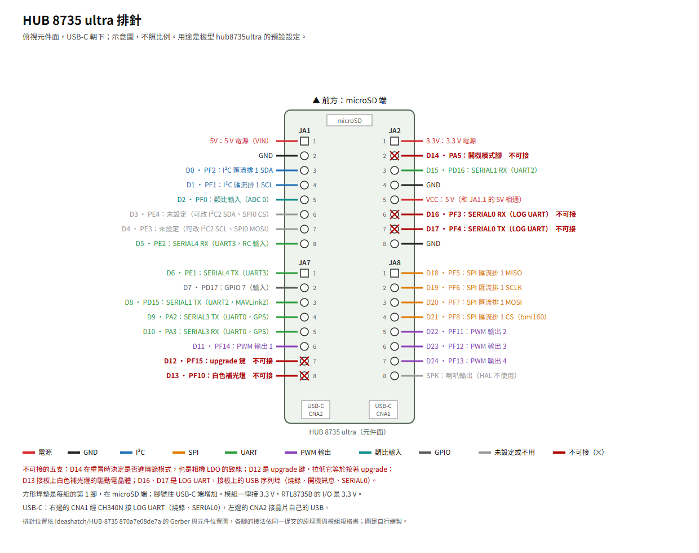

# HUB 8735 ultra

[English](README.md)

## 簡介

HUB 8735 ultra 是 ideasHatch 的 RTL8735B 開發板，晶片在板上的 Winstec SM35B02 模組裡（原理圖 p.4）。板型 `hub8735ultra` 把它當成飛控用：排針的用途照板商 Arduino 套件的 variant（`variant.cpp`、`variant.h`），D 編號就是 variant 的 `AMB_Dn`，GPIO 的邏輯編號和 D 編號相同。本移植的開發與上板驗證都在這塊板子上做。

板上沒有 IMU、氣壓計與羅盤（原理圖、BOM），感測器接在排針上，見〈接線圖〉。這塊板子的現況見[現況](#現況)。

## 規格

- 處理器：Realtek RTL8735B（Winstec SM35B02 模組，原理圖 p.4）；板商 Arduino 板定義的 CPU 時脈是 500 MHz（`boards.txt`）。
- 記憶體：外部 SPI Flash 16 MB（XT25F128B，原理圖 p.4、BOM）；DDR 128 MB（板商 Arduino 套件 4.1.1 的連結腳本）。
- 無線：Wi-Fi，見〈Wi-Fi 模組〉。
- 儲存：microSD 卡座，4 位元 SD（原理圖 p.7）。
- USB：兩個 USB-C，從元件面看 CNA2 在左、CNA1 在右（Gerber）。CNA1 經 CH340N 接晶片的 LOG UART，燒錄、開機訊息與 SERIAL0 都走它；CNA2 接晶片自己的 USB，本移植不用（原理圖 p.9）。
- 排針：兩排各 16 腳，2.54 mm，兩排相距 22.86 mm（Gerber）。
- 按鍵：reset、upgrade（原理圖 p.4、p.8）。
- LED：紅色（電源，沒有控制腳）、綠色（D25）、藍色（D26）、白色補光燈（D13）（原理圖 p.8）。
- 其他：相機的 MIPI FPC 座與數位麥克風，本移植不用。
- 電源：5 V（VIN），板商表列 4.75–5.25 V；I/O 3.3 V（模組規格書 p.4）。
- 尺寸：53 × 27 mm（模組規格書 p.4）。

### 現況

| 項目 | 狀態 |
|---|---|
| 照〈接線圖〉接感測器，地面站經 Wi-Fi（UDP）連線 | 能用（T2） |
| 加擴充板裝在 3.5 吋四軸上飛行，DShot300 | 能用（T5） |
| 經 CNA1 手動燒錄 | 能用（T1） |
| `--upload` | 要補：上板驗一次 |
| SERIAL0：USB 序列埠上的 MAVLink | 要補：上板驗一次 |
| SERIAL1、SERIAL3、SERIAL4 | 要補：上板驗一次 |
| GPS 接 SERIAL3 或 SERIAL1 | 要補：接 GPS 驗一次 |
| 遙控接收機接 SERIAL4 | 要補：接接收機驗一次 |
| PWM 輸出 1–4：一般 PWM、OneShot、OneShot125、有刷、DShot150、DShot600 | 要補：接電調或馬達驗一次 |
| Wi-Fi MAVLink（TCP） | 要補：上板驗一次 |
| GPIO：D7、D25 與 D26 的 LED | 要補：上板驗一次 |
| D2 以外的類比腳 | 要補：上板驗一次 |
| 電池電壓與電流 | 要補：校正 |
| 羅盤 | 要補：確認方向並校正 |
| microSD 卡 | 要補：接卡驗一次 |
| D3、D4 的 I²C 匯流排 2 | 要補：上板驗一次 |
| I²C 空速計 | 要補：上板驗一次 |

HAL 各功能的現況與說明見[功能狀態](../../docs/feature-status.zh-TW.md)。

## 購買

這塊開發板由 ideasHatch 製作。板商的文件與 Arduino 套件在 [ideashatch/HUB-8735](https://github.com/ideashatch/HUB-8735)；這裡用到的板商文件沒有寫販售的連結。

## 接腳



向量圖：[pinout.zh-TW.svg](pinout.zh-TW.svg)。

從元件面看、USB-C 朝下：左排上組 JA1、下組 JA7，右排上組 JA2、下組 JA8，每組 8 腳。每組的第 1 腳是方形焊墊，在 microSD 那一端，腳號往 USB-C 端增加（Gerber、元件位置圖）。

電源與地：

- 5V（JA1.1）就是 VIN；VCC（JA2.5）經 0 Ω 接 VIN；兩個 USB-C 的 VBUS 也直接接 VIN，中間沒有二極體或切換電路（原理圖 p.7、p.9）。
- 3.3V（JA2.1）經 0 Ω 接板上的 3.3 V 穩壓輸出（原理圖 p.7、p.8）。
- GND：JA1.2、JA2.4、JA2.8。

板上已經接了東西的腳（圖上標 ✕）：

| 腳 | 排針 | 板上接到 |
|---|---|---|
| D12（PF15） | JA7.7 | upgrade 鍵：10 kΩ 上拉到 3.3 V，按下時接地。這個節點也經 QA7 把 D14（PA5）拉高，所以把 D12 拉低等於按著 upgrade 鍵（原理圖 p.8） |
| D13（PF10） | JA7.8 | 白色補光燈的驅動電晶體（經 1 kΩ），10 kΩ 下拉（原理圖 p.8） |
| D14（PA5） | JA2.2 | 開機模式腳：重置時的電位決定是否進燒錄模式（原理圖 p.4）；也是相機電源 LDO 的致能。旁邊就是 3.3V（JA2.1） |
| D16（PF3） | JA2.6 | LOG UART RX，接板上 CH340N 的 TXD（原理圖 p.9） |
| D17（PF4） | JA2.7 | LOG UART TX，接板上 CH340N 的 RXD（原理圖 p.9） |

SPK（JA8.8）是音訊輸出，本移植不用。

匯流排：

| 匯流排 | 腳 | 說明 |
|---|---|---|
| I²C 匯流排 1（SDK 的 I2C1） | D0（PF2，SDA，JA1.3）、D1（PF1，SCL，JA1.4） | 400 kHz，標為 `external`。板上沒有上拉電阻（原理圖 p.7）：靠模組自帶的上拉，或另加 |
| SPI 匯流排 1（SDK 的 SPI1） | D18（PF5，MISO，JA8.1）、D19（PF6，SCLK，JA8.2）、D20（PF7，MOSI，JA8.3）、D21（PF8，CS，JA8.4） | SPI 裝置 `bmi160` 的 CS 是 D21，mode 0，1 MHz／10 MHz |

- D3（PE4，JA1.6）、D4（PE3，JA1.7）沒有設定。疊加檔可以把它們設成 SDK 的 I2C2（D3 SDA、D4 SCL），例如 `RTL8735B_I2CBUS 2 2 PIN_E4 PIN_E3 400000 external`；或當 SPI0 的 CS、MOSI（SPI0 的 SCLK、MISO 是 PE1、PE2，所以先停用 SERIAL4）。
- I²C 用 SDK 的編號：`variant.h` 把 PE4／PE3 標成 I2C0、PA1／PA0 標成 I2C2，SDK 的腳位表相反（`component/mbed/targets/hal/rtl8735b/i2c_api.c`）。

## 接線圖

板型本身不含感測器。沒有氣壓計時，開機會停在 `Config Error: Baro: unable to initialise driver`，這時 Wi-Fi 也不會有 MAVLink。照下面的接法，開機後三個感測器都偵測到，Wi-Fi 地面站收得到心跳與參數，參數在重開機後保留，抬起開發板前、後端時姿態跟著動（[BOARD_TESTS.md](../../BOARD_TESTS.md) 的 T2）。

| 感測器 | 模組 | 接到 |
|---|---|---|
| IMU | GY-BMI160 | SPI 匯流排 1：D18（MISO，接模組的 SAO／SDO）、D19（SCLK，接 SCL）、D20（MOSI，接 SDA）、D21（CS） |
| 氣壓計 | BMP280 | I²C 匯流排 1：D0（SDA）、D1（SCL）；SDO 接 GND（位址 0x76），CSB 接 3.3 V（選 I²C 模式） |
| 羅盤 | GY-271（QMC5883L） | I²C 匯流排 1：和 BMP280 共用 D0、D1 |

- 三個模組接 3.3V（JA2.1）與 GND。模組上的腳名依廠商不同，以手上模組的絲印為準。
- 這個接法的疊加檔在範例庫：[`examples/bmi160-bmp280-qmc5883l/overlay.dat`](https://github.com/rainwu0/ArduPilot-Hub8735Ultra/blob/v0.1.0/examples/bmi160-bmp280-qmc5883l/overlay.dat)（rainwu0/ArduPilot-Hub8735Ultra `v0.1.0`），範例的 README 有接線圖、參數與檢查方法。

```bash
git clone --branch v0.1.0 https://github.com/rainwu0/ArduPilot-Hub8735Ultra.git ~/ArduPilot-Hub8735Ultra
./waf configure --board hub8735ultra --extra-hwdef ~/ArduPilot-Hub8735Ultra/examples/bmi160-bmp280-qmc5883l/overlay.dat
./waf copter
```

安裝方向：

- IMU 的 `ROTATION_*` 要實測，不能只看模組的絲印。元件面朝上的 GY-BMI160 配 `ROTATION_NONE` 時，水平放著的開發板被當成上下顛倒。範例疊加檔裡的值是範例開發板實測的結果：元件面朝上，前方是 USB 接頭的另一端。
- 換了擺法要重測：開發板前端抬起時 pitch 變正，水平放著時 roll、pitch 接近 0。
- 整片開發板在機身上轉了方向時，用參數 `AHRS_ORIENTATION` 調整，不必改疊加檔。外接羅盤的方向用參數 `COMPASS_ORIENT`。

其他感測器、腳位與匯流排：[描述自己的開發板](../../docs/custom-boards.zh-TW.md)。

## UART 對應

| SERIALn | 晶片的 UART | TX | RX | 預設協定 | 說明 |
|---|---|---|---|---|---|
| SERIAL0 | UART1（LOG UART） | D17（PF4，JA2.7） | D16（PF3，JA2.6） | MAVLink2，115200 baud | 經板上的 CH340N 接到 USB-C CNA1 |
| SERIAL1 | UART2 | D8（PD15，JA7.3） | D15（PD16，JA2.3） | MAVLink2，115200 baud | |
| SERIAL2 | — | — | — | MAVLink2 | Wi-Fi（UDP 或 TCP），見〈Wi-Fi 模組〉 |
| SERIAL3 | UART0 | D9（PA2，JA7.4） | D10（PA3，JA7.5） | GPS | |
| SERIAL4 | UART3 | D6（PE1，JA7.1） | D5（PE2，JA1.8） | RC 輸入 | |

- SERIAL5–SERIAL9 沒有設定。
- 序列埠支援 8 個資料位元、無／奇／偶同位元、1 或 2 個停止位元（SDK `d1b6426` 的 `hal_uart_set_format`）；不支援一般模式的反相，也不支援單線半雙工。
- RTL8735B 的 I/O 是 3.3 V；板商文件沒有寫腳是否承受得了 5 V。5 V 準位的裝置經準位轉換接。
- GPS 接 SERIAL3：GPS 的 TX 接 D10（RX），RX 接 D9（TX）。`SERIAL3_PROTOCOL` 預設就是 5（GPS），鮑率由 ArduPilot 自動找。接在 SERIAL1 時，`SERIAL1_PROTOCOL` 設成 5。
- 狀態：見[現況](#現況)。

### SERIAL0：USB 序列埠上的 MAVLink

- SERIAL0 是 LOG UART，經板上的 CH340N 接到 USB-C CNA1，也就是燒錄用的那個埠。`SERIAL0_PROTOCOL` 預設 2（MAVLink2），`SERIAL0_BAUD` 預設 115：地面站接這個 COM 埠、115200 baud 就能連線，不需要 Wi-Fi。
- HAL 初始化時（排程器建好之後、`setup()` 與參數區初始化之前）就開始用 SERIAL0。在那之前，開機程式與 SDK 的開機訊息照常從這個埠印出，用一般的序列埠終端機、115200 baud 讀得到；之後 SDK 與 HAL 以 printf 印的文字都不送出，不插進 MAVLink 封包之間（[原因](../../docs/design.zh-TW.md#serial0-只送-mavlink不送文字)）。HAL 的執行期訊息以 STATUSTEXT 送到地面站：馬達輸出的頻率與模式、Wi-Fi 的連線經過（`WiFi: joining`、`WiFi: up, local <IP>:<埠>`、`WiFi: join failed`、`WiFi: no STA credentials`）與斷線。所以地面站接這個 COM 埠就讀得到開發板在 Wi-Fi 上的 IP。
- 當機（HardFault）時，經 SDK 印的傾印看不到；把 SERIAL0 關掉就看得到。
- ArduPilot 開始用 SERIAL0 之後，這個埠收到的位元組只交給 MAVLink，SDK 主控台不再收指令。
- 燒錄也用這個埠，所以燒錄時地面站先斷開它。
- 關掉 SERIAL0：疊加檔寫 `undef HAL_RTL8735B_SERIAL0_ENABLED`，再 `define HAL_RTL8735B_SERIAL0_ENABLED 0`。
- 晶片自己的 USB（CNA2）不做 MAVLink：SDK 公開的原始碼裡，USB 裝置端只有標頭，沒有實作。

## PWM 輸出

| 輸出 | 腳 | 排針 | 晶片的 PWM |
|---|---|---|---|
| 1 | D11（PF14） | JA7.6 | PWM8 |
| 2 | D22（PF11） | JA8.5 | PWM5 |
| 3 | D23（PF12） | JA8.6 | PWM6 |
| 4 | D24（PF13） | JA8.7 | PWM7 |

- 輸出方式（一般 PWM、OneShot、OneShot125、有刷、DShot150／300／600）與限制見[馬達輸出](../../docs/motor-outputs.zh-TW.md)。
- 四路都在 GPIO 埠 F，DShot 各路可以同時送。
- 晶片上另有幾支腳有 PWM 功能，但已經有別的用途，板型沒有設成輸出：D19、D20、D21（PWM0–2）是 SPI 匯流排 1，D13（PWM4）接補光燈，D12（PWM9）接 upgrade 鍵。
- 狀態：見[現況](#現況)。

## RC 輸入

- RC 接收機接 SERIAL4：接收機的 TX 接 D5（RX），RX 接 D6（TX）。`SERIAL4_PROTOCOL` 預設就是 23（RC 輸入）。
- 支援不反相的序列 RC 協定，例如 CRSF／ELRS（416666 baud，8N1）與 115200 baud 的協定。ArduPilot 輪流試各種格式時，埠開著就直接換格式。
- SBUS（100000 baud、8E2）的訊號是反相的，而晶片的 UART 沒有一般模式的反相功能（[原因](../../docs/design.zh-TW.md#序列埠沒有反相)），所以 SBUS 經外接反相器，或用接收機上不反相的 SBUS 輸出，接到 D5。
- 沒有 PPM 或專用的 RC 輸入腳：RC 輸入只有序列埠。
- 地面站的 RC override 走 MAVLink，不經過這個埠。
- 狀態：見[現況](#現況)。

## Wi-Fi 模組

- 開發板的 Wi-Fi 以 station（STA）模式在 SERIAL2 跑 MAVLink：預設 UDP，或在疊加檔改成 TCP server。設定檔、埠、訊息與安全上的限制見 [Wi-Fi](../../docs/wifi.zh-TW.md)。
- 狀態：見[現況](#現況)。
- 要等氣壓計初始化之後，Wi-Fi 通道才有 MAVLink，見〈接線圖〉。

## GPIO

| 邏輯編號 | 腳 | 方向 | 說明 |
|---|---|---|---|
| 7 | D7（PD17，JA7.2） | 輸入 | |
| 25 | D25（PE6） | 輸出 | 綠色 LED（不在排針上） |
| 26 | D26（PF9） | 輸出 | 藍色 LED（不在排針上） |

- D27（PA0）、D28（PA1）、D29（PE5）是板上的測試點，不在排針上（原理圖 p.7–8）。
- GPIO 可以用疊加檔的 `RTL8735B_GPIO` 改設，格式見 [hwdef 設定](../../docs/hwdef.zh-TW.md)。

## 類比腳

- 類比腳 2 是 D2（PF0，ADC 通道 0，JA1.5）。
- 滿刻度 3.3 V；換算見[功能狀態](../../docs/feature-status.zh-TW.md)的電池電壓列。類比腳能承受的電壓上限，板商文件沒有寫。
- 其他可以當類比輸入的腳，用疊加檔的 `RTL8735B_ADC` 加：D1（PF1，ADC 1）、D0（PF2，ADC 2）、D16（PF3，ADC 3）、D27（PA0，ADC 4）、D28（PA1，ADC 5）、D9（PA2，ADC 6）、D10（PA3，ADC 7）（SDK `d1b6426` 的 `analogin_api.c`）。D0、D1 是 I²C 匯流排 1，D16 是 LOG UART，D9、D10 是 SERIAL3：當類比用之前，先把原本的用途拿掉。
- 板商 Arduino 套件把 D11、D12 標成 `PIO_ADC`，但它們不在 SDK 的 ADC 腳位表裡，不能當類比輸入。
- 沒有預留給 RSSI 或類比空速計的腳。I²C 空速計在設了 `ARSPD_TYPE` 之後，於 `external` 匯流排上尋找，見[描述自己的開發板](../../docs/custom-boards.zh-TW.md)。

## 電池監測

- 開發板上沒有電池的分壓與電流輸入。
- 電池電壓經分壓接類比腳。例如接 D2：`BATT_MONITOR` 設 3（類比電壓），`BATT_VOLT_PIN` 設 2，分壓比設在 `BATT_VOLT_MULT`。
- 有遙測的電調也可以當電池監測（`BATTn_MONITOR` 9），見[馬達輸出](../../docs/motor-outputs.zh-TW.md)。
- 狀態：見[現況](#現況)。

## 羅盤

- 開發板上沒有羅盤。
- 外接的 I²C 羅盤接 I²C 匯流排 1，或用疊加檔把 D3、D4 設成 I²C 匯流排 2；排針上沒有上拉電阻。疊加檔要寫 `COMPASS` 列，見[描述自己的開發板](../../docs/custom-boards.zh-TW.md)。
- 狀態：見[現況](#現況)。

## 韌體

```bash
./waf configure --board hub8735ultra
./waf copter
```

- 映像是 `build/hub8735ultra/sdk_build/flash_ntz.bin`。工具與 SDK 的安裝、Wi-Fi 設定檔，見[建置韌體](../../docs/building.zh-TW.md)。
- `hwdef.dat` 只換板名，其餘設定來自 [`../rtl8735b-empty/hwdef.dat`](../rtl8735b-empty/hwdef.dat)。
- 本儲存庫不提供韌體映像。

## 燒錄韌體

1. 用 USB-C CNA1（接 CH340N 的那一個）接電腦。燒錄用的和 SERIAL0 是同一個埠，所以地面站先斷開它。
2. 讓晶片進入燒錄模式：按住 upgrade 鍵，短按 reset，再放開 upgrade（英文使用手冊 p.15）。另一種做法是把 D14（JA2.2）和 3.3V（JA2.1）短路後按 reset，燒完移除短路再按 reset（中文使用說明 p.17–18）。依原理圖 p.4 的開機模式表，PA5（D14）與 PE5（D29）都是高電位時進燒錄模式；PE5 板上有 10 kΩ 上拉。
3. 燒錄 `flash_ntz.bin`：`--upload`，或手動用 SDK 附的 `uartfwburn`，指令見[燒錄韌體](../../docs/flashing.zh-TW.md)。看到 `download success` 後按一次 reset 就開機。

## 其他連結

- [從零開始](../../GETTING_STARTED.zh-TW.md)：從這塊開發板與兩個感測器模組，到地面站顯示開發板的姿態。
- 板商文件都在 [ideashatch/HUB-8735](https://github.com/ideashatch/HUB-8735) 的提交 `870a7e08de7a`：
  - 原理圖：`HUB 8735 ultra toolkit/Hardware/HUB 8735 ultra Schematic.pdf`（Rev 02、PCB V02；頁碼指 PDF 頁）
  - 模組規格書：`HUB 8735 ultra toolkit/Hardware/HUB 8735 ultra Module Specification_V01_20240508.pdf`
  - BOM：`HUB 8735 ultra toolkit/Hardware/HUB 8735 ultra_BOM.xls`
  - Gerber 與元件位置圖：`HUB 8735 ultra toolkit/Hardware/HUB 8735 ultra PCB Gerber File.7z`、`HUB 8735 ultra toolkit/Hardware/HUB 8735 ultra_PCB Placement_Top.pdf`
  - 英文使用手冊：`HUB 8735 ultra toolkit/Software/HUB 8735 ultra User Manual【AIoT Starter Kit for Arduino】20240530.pdf`
  - 中文使用說明：`HUB 8735 ultra toolkit/Software/HUB 8735 ultra 開發板【Arduino 使用說明】_20240508.pdf`
  - Arduino 板定義：`amebapro2_arduino/Arduino_package/hardware/variants/ameba_hub8735_ultra/variant.cpp`、`variant.h`、`amebapro2_arduino/Arduino_package/hardware/boards.txt`
- 周邊的腳位表依 Realtek SDK `d1b6426`（[ambiot/ambpro2_sdk](https://github.com/ambiot/ambpro2_sdk)）的 `component/mbed/targets/hal/rtl8735b/`。接腳圖是本庫自行繪製。
